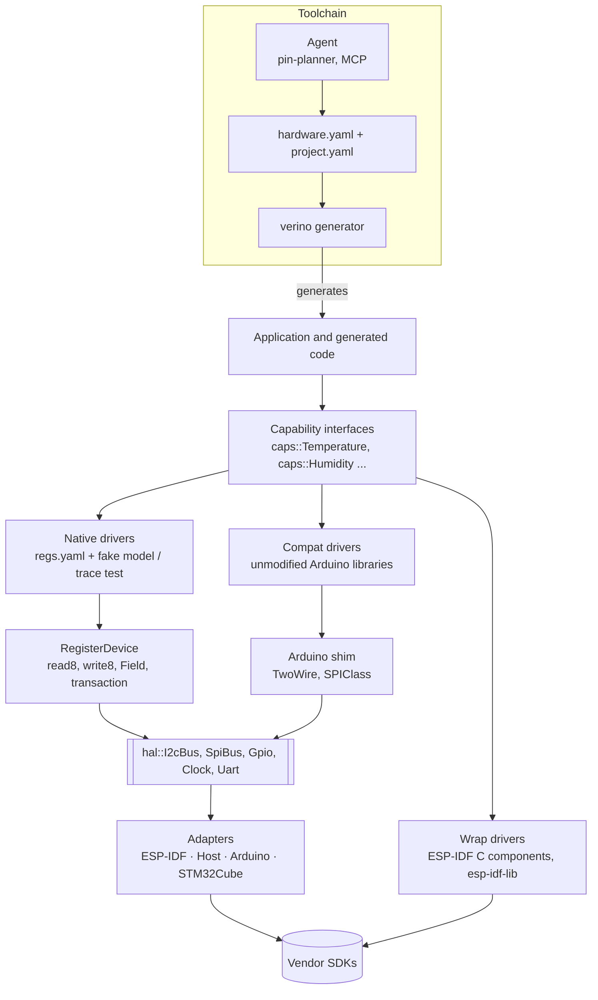
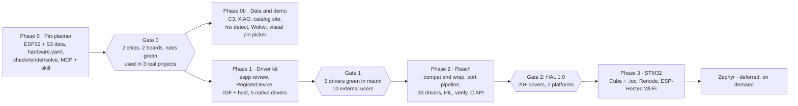

# Verino architecture overview

This is the English summary. The full design (v0.2) is in Turkish: [`docs/tr/architecture.md`](tr/architecture.md). Decisions are recorded in [`docs/adr/`](adr/).

## Three products, one data foundation

| Product | Contents | Value on its own |
| --- | --- | --- |
| Hardware toolkit | Chip and board data, `hardware.yaml`, pin-planner skill, `verino pins` / `verino hw` | Catches pin and memory mistakes before hardware |
| Driver kit | HAL, `RegisterDevice`, adapters, native/compat/wrap drivers, fake models and trace tests | Portable, testable, chip-independent drivers |
| Catalog | Site, verification matrix, `index.json`, MCP | Shows humans and agents what was verified where |

## Principles (short)

1. Thin layer, thick SDK: wrap vendor SDKs, never replace them.
2. Drivers depend only on the HAL; no platform symbols in driver code (lint-enforced).
3. Strict C++17 subset: no heap, exceptions or RTTI in drivers.
4. Synchronous drivers, RTOS-independent; locking lives in adapters.
5. Data before code: register maps, pin tables and manifests are YAML.
6. Hardware (`hardware.yaml`) and software (`project.yaml`) are described separately.
7. If the vendor has a tool, it is the source (CubeMX for STM32).
8. The LLM talks, deterministic tools decide.
9. Porting is a design criterion (Adafruit_BusIO vocabulary).
10. Every native driver has a behaviour test (fake model or recorded trace).
11. Agents are first-class users.
12. Compatibility and size are measured, not estimated.
13. Verification status and data provenance are explicit.
14. Core is Apache-2.0.

## Layers

## Key design decisions

- **Error model:** sticky error only inside `RegisterDevice`; driver operations run in `dev_.transaction(...)`; every public method returns `[[nodiscard]] Status` or `Result<T>`.
- **Capabilities:** `sample()` takes one measurement; getters read the cached sample.
- **Register maps:** `regs.yaml` generates type-safe `constexpr` register types; importable from Rust device-driver YAML.
- **Hardware model:** chip → module → board → project layers, each in its own data file; every pin assignment carries `origin` (`schematic`, `user`, `board_default`, `solver`, `cubemx`) and may be `locked`.
- **Validation rules:** level 1 (facts from data, always errors), level 2 (boot and electrical compatibility from device manifests), level 3 (interrupts, sleep, power). Stable IDs, provenance, trigger/clean fixtures.
- **Build:** native ESP-IDF/CMake first, PlatformIO second; the `verino` CLI delegates to `idf.py` / `pio`.

## Roadmap

## Related projects

PinPilot and platformio-mcp (pin checks for agents), espp and esp-idf-lib (ESP-IDF drivers), SensorLib (IDF + Arduino sensor drivers), Rust embedded-hal + device-driver (chip-independent drivers, YAML register maps). Verino differentiates by depth of hardware data, explicit provenance and verification, and agent-first tooling.
