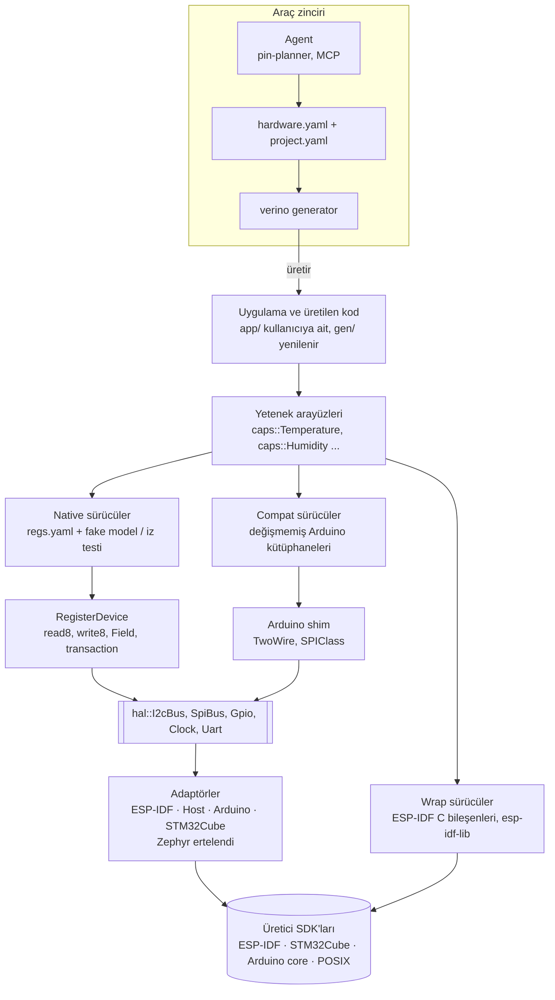
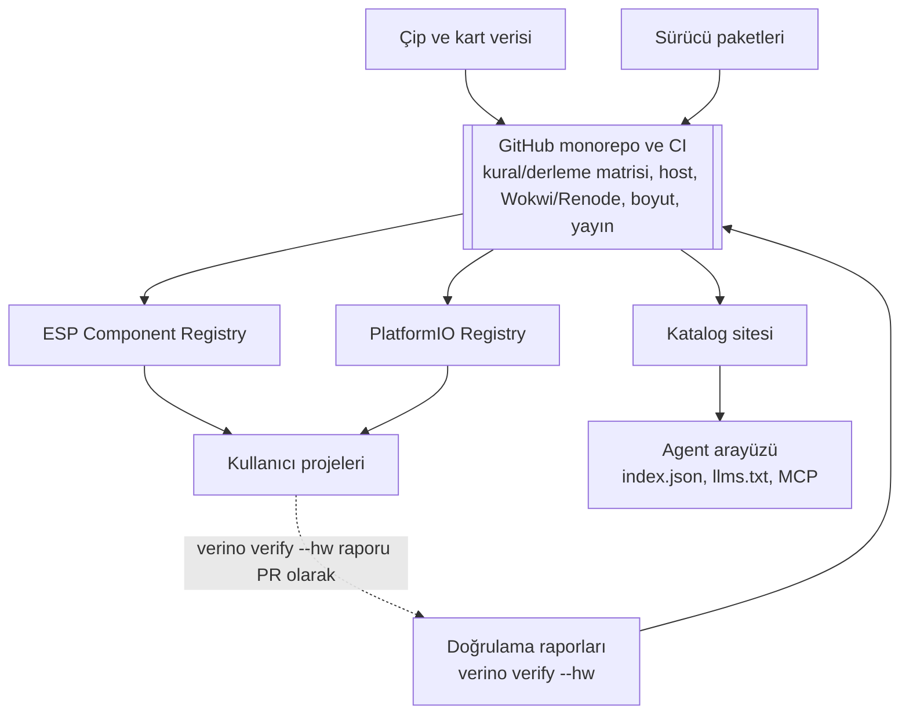
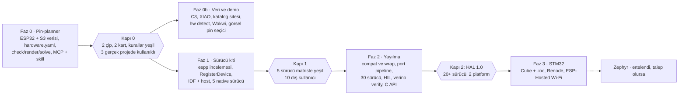

# Verino — Mimari Doküman v0.2 (Türkçe)

18 Kasım 2026 · Canlı sürüm: https://claude.ai/artifact/XzDonVvVSsYAvkQYWvcJCo

Bu sürüm, v0.1'in değerlendirmesinde onaylanan kararları işler: Faz 0 küçüldü, Zephyr ertelendi, hata modeli ve yetenek arayüzü netleşti, lisans Apache-2.0 oldu. Değişikliklerin listesi sondaki "v0.2'de değişenler" bölümündedir.

## Amaç ve kapsam

Proje, ESP32 ile başlayıp STM32 ve diğer çiplere genişleyen, test edilmiş, çipten bağımsız ve LLM agent'larının okuyup birleştirebildiği bir C++ sürücü ve servis katmanı kurar. Altta üretici SDK'ları (ESP-IDF, STM32Cube) çalışır; proje yeni bir RTOS ya da paket yöneticisi yazmaz.

**Konumlandırma.** Proje en çok sürücüyü sunmayı değil, agent'ın tahmin etmek zorunda kalmadığı, doğrulanmış bir donanım katmanı olmayı hedefler. Fark sürücü sayısından değil; doğrulamadan, ölçümden ve agent uyumundan gelir.

Proje tek bir veri temelini (çip, kart ve sürücü manifestleri) paylaşan üç üründen oluşur; her biri tek başına kullanılabilir.

| Ürün | İçerik | Tek başına değeri |
| --- | --- | --- |
| 1. Donanım araç seti | Çip ve kart verisi, `hardware.yaml`, pin-planner skill'i, `verino pins/hw` | Pin ve bellek hatalarını donanıma gelmeden yakalar |
| 2. Sürücü kiti | HAL, `RegisterDevice`, adaptörler, native/compat/wrap sürücüler, fake modeller ve iz testleri | Port edilebilir, test edilebilir, çipten bağımsız sürücüler |
| 3. Katalog | Site, doğrulama matrisi, `index.json` ve MCP | Neyin nerede doğrulandığını insan ve agent için görünür kılar |

**Çözülen problemler**

- Aynı sensör için çok sayıda, arayüzü farklı ve test durumu belirsiz kütüphane var.
- Arduino API'si (global `Wire`, hata dönüşü yok) sürücü standardı olmaya uygun değil; ESP-IDF güçlü ama C ve ESP'ye özel.
- Sürücüler bus, pin, adres ve doğrulama bilgisini makinenin okuyabileceği biçimde taşımıyor; agent'lar tahmin yürütüyor.
- Çipler arası taşıma (ESP32 → STM32) sürücüleri yeniden yazmayı gerektiriyor.

**Hedef**

- Kart, bellek ve pin yapılandırmasını bir skill ve deterministik bir araçla planlayıp `hardware.yaml` dosyasına yazmak; strapping, boot güvenliği ve gerilim hatalarını donanıma gelmeden yakalamak.
- `hardware.yaml` ve `project.yaml` dosyalarından derlenebilir, okunabilir, düzenlenebilir C++ projesi üretmek.
- Her sürücüyü PC'de (fake model veya iz testi), emülatörde (Wokwi/Renode) ve opsiyonel olarak donanımda test etmek.
- Aynı sürücüyü ESP-IDF, STM32Cube ve Arduino'da değiştirmeden çalıştırmak.

**Kapsam dışı**

- Yeni bir RTOS, yeni bir paket yöneticisi, yeni bir build sistemi.
- Wi-Fi/BLE yığınlarının kendisi: üretici yığınları kullanılır.
- ESPHome ile yarışan bir varlık ve otomasyon modeli: ağ servisleri ve varlık modeli çekirdekte değil, Faz 2 sonrası opsiyonel pakettir.
- Çipe özgü ileri özellikler (ULP, PIO, motor kontrol timer'ları): geliştirici doğrudan SDK'ya iner.
- Zephyr adaptörü: ertelendi, talep olursa gelir. Zephyr'in kendi sensör API'si ve devicetree'si olduğu için getirisi düşük.

## Emsal projeler

Pin planlama ve C/C++ sürücü alanı boş değil; sürücü sayısında yarışılmaz, derinlik ve doğrulamayla ayrışılır.

| Proje | Ne yapıyor | Bu projeden farkı |
| --- | --- | --- |
| [PinPilot](https://lablab.ai/u/@El_Ingeniero) (Eylül 2026) | ESP32 pinlerini otomatik atar, tek bir pin kaynağına karşı doğrular | Modül ve kart revizyonu, cihazın reset seviyesi, ölçülmüş boot davranışı yok |
| [platformio-mcp](https://glama.ai/mcp/servers/jqi9niggm5) | Karta göre GPIO güvenlik denetimi, build ve flash araçları | Pin denetimi sığ; donanım tanım dosyası yok |
| [espp](https://components.espressif.com/components/espp/base_peripheral) | ESP-IDF için C++ `base_peripheral`, ona bağlı \~40 sürücü bileşeni | Yalnızca ESP; doğrulama matrisi ve agent manifesti yok. Faz 1'de incelenir |
| [esp-idf-lib](https://components.espressif.com/components/esp-idf-lib/esp_idf_lib_helpers/versions/1.4.0/dependents) | Onlarca C sürücüsü, ESP Component Registry'de | C ve yalnızca ESP; wrap tier'ının kaynağı |
| [SensorLib](https://components.espressif.com/components/lewisxhe/sensorlib) | ESP-IDF ve Arduino için ortak I2C/SPI sensör sürücüleri | Doğrulama ve makine okunur manifest yok |
| [embedded-hal](https://blog.rust-embedded.org/embedded-hal-v1) + [device-driver](https://github.com/diondokter/device-driver) | Rust'ta çipten bağımsız sürücü arayüzleri; YAML'dan register API'si | Rust; `regs.yaml` device-driver YAML'ıyla eşlenir |

## Tasarım ilkeleri

On dört ilke tüm kararları bağlar; bir ilkeyle çelişen öneri ADR (mimari karar kaydı) ile gerekçelendirilir.

1. **İnce katman, kalın SDK.** Proje üretici SDK'larını sarmalar, yerine geçmez. Mbed'in kapanması kalın soyutlamanın riskini gösterdi.
2. **Sürücü sadece HAL'e bağlıdır.** Sürücü kodunda `esp_`, `HAL_`, `Wire` gibi platform sembolü geçmez; CI bunu lint ile denetler.
3. **C++17, katı alt küme.** Sürücüde heap, exception ve RTTI yok; kod `-fexceptions` ile de doğru derlenir. Kurallar "C++ kullanım profili" bölümündedir.
4. **Senkron sürücü, RTOS'tan bağımsız.** Sürücüler thread-safe değildir; kilitleme ve zamanlama adaptörün işidir.
5. **Veri koddan önce gelir.** Register haritaları, pin tabloları ve manifestler YAML'dır; C++ header'ları bunlardan üretilir.
6. **Donanım ve yazılım ayrı tanımlanır.** `hardware.yaml` donanımı, `project.yaml` yazılımı anlatır; üretilen C++ geliştiricinin sahiplendiği normal koddur.
7. **Üreticinin aracı varsa o kaynaktır.** STM32'de CubeMX, Zephyr'de devicetree kaynaktır ve içe aktarılır; ESP32'de kaynağı biz sağlarız.
8. **LLM konuşur, araç karar verir.** Pin, bellek ve uyumluluk kuralları deterministik araçlardadır.
9. **Port kolaylığı bir tasarım kriteridir.** HAL, Adafruit\_BusIO kelime dağarcığını izler; native, compat ve wrap tier'ları port yükünü kademelendirir.
10. **Her native sürücünün davranış testi vardır.** Fake model tercih edilir; yerine gerçek donanımdan kaydedilmiş bus izini tekrar oynatan bir test de kabul edilir. İkisinden biri olmadan native sürücü registry'ye girmez.
11. **Agent birinci sınıf kullanıcıdır.** İskelet üretici, her iş için tek kalıp, makine okunur manifest ve `AGENTS.md`.
12. **Uyumluluk ve boyut ölçülür.** Derleme matrisi bir kalite kapısıdır; manifestteki kaynak kullanımı tahmin değil ölçümdür.
13. **Doğrulama durumu ve veri kaynağı açıktır.** Sürücüler doğrulama seviyesini, çip verisi `provenance` etiketini taşır; katalog ikisini de gösterir.
14. **Çekirdek Apache-2.0 lisanslıdır.** GPL/LGPL bağımlılıklar yalnızca opsiyonel eklentilerde ve compat tier'ında, kendi lisanslarıyla bulunur.

## Katmanlı mimari

Sürücüler ve bağlantı servisleri yalnızca HAL arayüzlerini görür; platforma özgü her şey adaptörlerde durur. Araç zinciri (agent ve pin-planner, `hardware.yaml`, `project.yaml`, generator) bu yığının dışındadır ve yalnızca en üst katmanı üretir.



Oklar "kullanır" yönündedir. Uygulama yetenek arayüzlerini kullanır; native sürücüler `RegisterDevice` üzerinden, compat sürücüler Arduino shim'i üzerinden HAL'e iner; wrap sürücüler yalnızca ESP-IDF'e bağlıdır. Her adaptör HAL'i bir platform için uygular.

## C++ dil politikası

Sürücüler ve HAL header'ları **C++17** tabanıyla yazılır; `std::span` ve `std::expected` varsa kullanılır, yoksa projenin küçük yedek sınıfları devreye girer. Neden: aynı sürücü bir ortamda gnu++26, bir ortamda gnu++17, Zephyr'de varsayılan olarak C++11 ile derlenecek; exceptions bir ortamda açık, diğerlerinde kapalı.

**Dil seçimi.** C++ katı bir alt kümeyle kalır: port kaynakları (Adafruit, SparkFun) C++, `constexpr` register tipleri ve arayüzler C'de yok. C ile yazan IDF kullanıcıları için yetenek arayüzlerinden otomatik üretilen ince bir C API Faz 2'de gelir.

**Neden Rust değil.** Dört neden belirleyicidir:

1. Üretici SDK'ları (ESP-IDF, STM32Cube, Zephyr) C'dir; C++ bunları ek maliyet olmadan çağırır, Rust ise FFI ve unsafe sarmalayıcı ister ve bu katman her SDK sürümünde güncellenmelidir.
2. Rust dünyası SDK'yı sarmalamaz, yerine geçer: esp-hal ESP-IDF'ten bağımsızdır, STM32 tarafı CubeMX'i atlar. Bu, "ince katman" ve "üreticinin aracı kaynaktır" ilkeleriyle çelişir.
3. Port kaynakları (Adafruit, SparkFun) C++'tır; BusIO adlarıyla satır satır taşıma yalnızca C++'ta işler.
4. Hedef kitle (Arduino ve IDF kullanıcıları) C/C++ bilir.

Ayrıca Rust'ta bu projenin çekirdeği zaten var (embedded-hal, device-driver); boşluk C/C++ tarafındadır. Bellek ayırma bir gerekçe değildir: gömülü Rust no\_std ve heap'siz çalışır.

**Rust'tan alınan dersler.** embedded-hal'deki bus ile aygıt ayrımı (`I2cBus` / `I2cDevice`), platformdan bağımsız hata türleri ve bus paylaşımının ayrı bir katmanda çözülmesi örnek alınır. Rust derleyicisinin agent'a verdiği güçlü geri bildirimin karşılığı burada katı alt küme, lint, `[[nodiscard]]` ve `-Werror` matrisidir; bunlar sonradan eklenecek maddeler değil, çekirdeğin parçasıdır.

**Ortamların gerçek durumu (Kasım 2026)**

| Ortam | Derleyici | Varsayılan C++ | Exceptions / RTTI | C kütüphanesi |
| --- | --- | --- | --- | --- |
| ESP-IDF 6.x | GCC 15.1 | gnu++26 | Kapalı / kapalı (açılabilir) | Picolibc (Newlib seçilebilir) |
| ESP-IDF 5.x | GCC 14.2 (son 5.x) | gnu++2b (C++23) | Kapalı / kapalı | Newlib |
| Arduino-ESP32 3.x (pioarduino) | IDF 5.x GCC | gnu++2b; bazı sürümlerde `cpp_flags` ile gnu++17'ye eziliyor | **Açık** / kapalı | Newlib |
| PlatformIO resmi espressif32 (Arduino 2.0.17, IDF 4.4.7) | Eski GCC (8.x) | gnu++11 | — | Newlib |
| STM32CubeIDE 2.1 | GNU Tools for STM32 14.3, ST Arm Clang 21.1 | Proje ayarı | Proje ayarı | Newlib (nano) |
| Zephyr (ertelendi) | Zephyr SDK GCC | **C++11** (Kconfig ile C++23'e kadar) | Opsiyonel | Minimal libcpp varsayılan |

**Katmana göre standart**

| Katman | Taban | Gerekçe |
| --- | --- | --- |
| Sürücüler ve HAL header'ları | C++17 + özellik tespiti | En geniş ortam; concept ve coroutine kullanmadığımız için C++20'den vazgeçmenin bedeli düşük |
| Adaptörler | Kendi platformunun standardı | IDF adaptörü C++20/23 kullanabilir; Zephyr adaptörü (ertelendi) `STD_CPP17` ister |
| Host testleri ve araçlar | C++17 ve C++23, GCC ve Clang | İki uçta da derlendiğini kanıtlamak |

**Özellik tespiti (`verino/config.hpp`)**

```cpp
#if defined(__cpp_lib_span) && __cpp_lib_span >= 202002L
  #include <span>
  namespace verino { using std::span; }
#else
  #include "verino/detail/span.hpp"        // küçük, C++17 uyumlu yedek
#endif

#if defined(__cpp_lib_expected) && __cpp_lib_expected >= 202202L
  #include <expected>
  namespace verino { template <class T> using Result = std::expected<T, Error>; }
#else
  #include "verino/detail/result.hpp"      // aynı API'nin alt kümesi
#endif
```

Yalnızca std ile ortak API alt kümesi kullanılır; yedekten std'ye geçiş davranışı değiştirmez.

**C++17 tabanında kaçınılacaklar**

- Public header'larda designated initializer (C++20; IDF C++26'da bile bazı biçimlerini desteklemiyor).
- `dynamic_cast`, `typeid` (RTTI hiçbir hedefte varsayılan açık değil).
- `throw`, `try`; ama kod `-fexceptions` ile de doğru derlenmeli (Arduino-ESP32).
- Global nesne ve statik başlatma sırasına dayanan kod (Zephyr global yıkıcıları desteklemiyor).
- `printf` ve stdio (Picolibc ile Newlib farklı); loglama `hal::Log` üzerinden.
- `std::thread`, `std::mutex` (Zephyr'de yok); kilitleme adaptörde.
- `#pragma pack` ile bus verisini struct'a cast etmek (Cortex-M0'da HardFault, Xtensa'da exception); bayt dizisinden açık birleştirme.

**Kayan nokta**

| Çip | FPU |
| --- | --- |
| ESP32, ESP32-S3 | Tek hassasiyet; double yazılımla |
| ESP32-C3, C6 | Yok |
| STM32 F0, G0, L0 | Yok |
| STM32 F4, L4, G4 | Tek hassasiyet |
| STM32 H7, bazı F7 | Çift hassasiyet |

Sürücüler `double` kullanmaz, literaller `f` sonekiyle yazılır ve CI'da `-Wdouble-promotion` açıktır. Üreticinin tamsayı hesaplama yolu varsa (örn. BME280 int32 formülleri) sürücü onu da sunar; manifestte `fpu: optional`, FPU'suz hedefte tamsayı yolu varsayılan olur (`__ARM_FP`, `__riscv_flen` gibi makrolarla tespit).

## C++ kullanım profili ve HAL

HAL, Adafruit\_BusIO'nun kelime dağarcığını (`I2CDevice`, `SPIDevice`, `BusIO_Register`, `RegisterBits`) izler; böylece Adafruit sürücülerinin portu neredeyse satır satır, mekanik bir dönüşüme iner. Sürücülerin çoğu yalnızca `RegisterDevice` ve `Clock` kullanır.

| Katman | Kim yazar | API |
| --- | --- | --- |
| `hal::I2cBus`, `hal::SpiBus`, `hal::Gpio`, `hal::Clock`, `hal::Uart` | Adaptör | Sanal arayüz, korumalı ve sanal olmayan yıkıcı |
| `hal::I2cDevice`, `hal::SpiDevice` | Çekirdek | `write`, `read`, `write_then_read` (BusIO ile aynı adlar) |
| `hal::RegisterBus` / `hal::RegisterDevice` | Çekirdek | `read8`, `read16_be/le`, `write8`, `read_block`, `update_bits`, `transaction`; I2C ve SPI tek arayüzde |
| `regs.hpp` | `regs.yaml`'dan üretilir | `Reg<0xF4>`, `Field<7,5>` gibi tip güvenli `constexpr` tipler |
| `caps::*` | Çekirdek | `caps::Temperature`, `caps::Humidity`, `caps::Monochrome` gibi yetenek arayüzleri |
| Sürücü | İnsan veya agent | Yetenek arayüzlerini uygular |

```cpp
struct I2cBus {
  virtual hal::Status write_then_read(uint8_t addr, verino::span<const uint8_t> tx,
                                      verino::span<uint8_t> rx) noexcept = 0;
protected:
  ~I2cBus() = default;      // sanal değil, korumalı: deleting destructor ve operator delete bağlanmaz
};
```

**Kararlar**

| Konu | Karar |
| --- | --- |
| Hata modeli | Yapışkan hata yalnızca içeride kalır: sürücü işlemleri `dev_.transaction(...)` içinde yazılır ve bu yardımcı `Result<T>` döner. Public metotlar her zaman `[[nodiscard]] Status` ya da `Result<T>` döner; ham değer döndüren public metot yoktur. Makro yok, `TRY` yok. Kural yapısaldır, lint'e dayanmaz (hata enjeksiyon testleri ayrıca denetler) |
| Polimorfizm | Bus ve aygıt arayüzleri `virtual`; template yalnızca çekirdek yardımcılarda (`Reg`, `Field`, `Result`, `span`, `transaction`) |
| Nesne oluşturma | İki aşamalı: `constexpr noexcept` constructor yalnızca referans saklar, donanımla konuşan iş `init()`'te. Global nesneler sabit başlatılır |
| Sahiplik | Generator tüm nesneleri statik oluşturur; sürücüler bus'a referans tutar ve kopyalanamaz |
| Birimler | Düz `float` / tamsayı, birim isimde: `temperature_c`, `pressure_pa`, `delay_ms` |
| Callback | Fonksiyon işaretçisi + `void*` context; `std::function` yok. Sürücüler ISR sahiplenmez; kesme adaptörde yakalanır, `on_interrupt()` görev bağlamında çağrılır |
| Eşzamanlılık | Sürücüler thread-safe değil; bir örnek tek görevde kullanılır; bus kilidi adaptörde |
| Yavaş sensörler | Bloklayan `read()` yanında `start()` / `ready()` / `fetch()`; coroutine yok |
| Yetenek arayüzü | `sample()` tek ölçüm alır ve zaman damgasıyla saklar; `temperature_c()`, `humidity_pct()` gibi getter'lar bus'a gitmeden son ölçümden okur. Sıcaklık ve nem aynı andan gelir, bus trafiği ikiye katlanmaz |
| Bellek | Sürücüde heap yok; büyük buffer'lar `verino::span` ile dışarıdan |

**Kullanım profili**

| İzinli | Kısıtlı | Yasak |
| --- | --- | --- |
| `constexpr`, `enum class`, `[[nodiscard]]`, `noexcept`, `static_assert` | Template: yalnızca `core/`; sürücü public API'sinde yok | `throw`, `try`, `dynamic_cast`, `typeid` |
| `std::array`, `std::optional`, `verino::span`, `verino::Result` | `float`: `f` sonekli; FPU'suz hedefte tamsayı yolu | Sürücüde `new`, `malloc`, `std::vector`, `std::string` |
| `<cstdint>`, `<cstring>` | `-O2` dosya bazında, gerekçeyle | `std::function`, `<iostream>`, `printf`, `std::thread`, `std::mutex` |
| Referansla bağımlılık verme | Makro: yalnızca `VERINO_LOG_*`, `VERINO_ASSERT` | `double`, `#pragma pack` cast |
| Tek seviye arayüz kalıtımı | Fonksiyon içi `static`: yalnızca `constexpr` | Generator dışında global değiştirilebilir nesne, çok seviyeli kalıtım |

**Adlandırma:** tipler `PascalCase`, fonksiyon ve değişkenler `snake_case`, üyeler `name_`, sabitler `kName`, isim alanları `verino::hal`, `verino::drv`, `verino::caps`.

**Kanonik sürücü**

```cpp
namespace verino::drv {

class Bme280 final : public caps::Temperature, public caps::Humidity {
public:
  struct Measurement { float temperature_c; float pressure_pa; float humidity_pct; };

  constexpr Bme280(hal::RegisterBus& bus, hal::Clock& clk) noexcept : dev_(bus), clk_(clk) {}
  Bme280(const Bme280&) = delete;
  Bme280& operator=(const Bme280&) = delete;

  [[nodiscard]] hal::Status init(const Config& cfg = {}) noexcept;
  [[nodiscard]] hal::Result<Measurement> read() noexcept;       // bloklayan
  [[nodiscard]] hal::Status start() noexcept;                   // bloklamayan üçlü
  [[nodiscard]] bool ready() noexcept;
  [[nodiscard]] hal::Result<Measurement> fetch() noexcept;

  [[nodiscard]] hal::Status sample() noexcept;                  // caps: tek ölçüm, getter'lar bundan okur
  [[nodiscard]] hal::Result<float> temperature_c() noexcept override;
  [[nodiscard]] hal::Result<float> humidity_pct() noexcept override;

private:
  hal::RegisterDevice dev_;     // yapışkan hata yalnızca burada, transaction() dışarı Status verir
  hal::Clock& clk_;
  Calibration cal_{};
  Measurement last_{};          // sample() sonucu, getter'lar buradan okur
};

}  // namespace verino::drv

hal::Status Bme280::init(const Config& cfg) noexcept {
  return dev_.transaction([&]() -> hal::Status {
    dev_.write8(reg::Reset::addr, reg::Reset::kSoftReset);
    clk_.delay_ms(10);
    if (dev_.read8(reg::ChipId::addr) != reg::ChipId::kExpected)
      return hal::Error::NotFound;
    read_calibration();
    dev_.write(reg::CtrlMeas{}.osrs_t(cfg.osrs_t).mode(reg::Mode::Sleep));
    return hal::Ok;
  });
}
```

**Kullanıcının gördüğü yüz**

```cpp
// Generator ile (gen/parts.hpp): constexpr constructor sayesinde sabit başlatılır
inline verino::drv::Bme280 env{board::i2c0_dev_0x76, board::clock};

// Arduino ile (generator olmadan)
#include <verino/arduino.hpp>
#include <verino/drv/bme280.hpp>
auto bus  = verino::arduino::i2c(Wire, 0x76);
auto& clk = verino::arduino::clock();
verino::drv::Bme280 env{bus, clk};
void setup() { Wire.begin(); if (!env.init()) Serial.println("BME280 yok"); }
void loop()  { if (auto m = env.read()) Serial.println(m->temperature_c); delay(1000); }
```

**Araçlar:** `.clang-format` (Google tabanlı, 100 sütun); clang-tidy (`bugprone-*`, `performance-*`, seçili `cppcoreguidelines-*`, `readability-identifier-naming`); test için doctest; mock kütüphanesi yerine fake implementasyonlar ve iz testleri. MISRA C++:2023 ve C++ Core Guidelines referans olarak kullanılır, birebir zorunlu değil.

## Sürücü tier'ları ve port stratejisi

Port yükünü azaltmak için üç yol vardır: popüler sürücüler native yazılır, uzun kuyruk compat ile hemen kullanılabilir olur, iyi ESP-IDF C bileşenleri wrap ile sarılır. Katalog her sürücünün tier'ını açıkça gösterir; manifestte `tier: native | compat | wrap` alanı bulunur.

| Tier | Nasıl | Platform | Doğrulama | Lisans |
| --- | --- | --- | --- | --- |
| **native** | `RegisterDevice` ile yeniden yazım (agent port pipeline'ı) | Tümü | Host (fake model veya iz testi), emülatör, donanım | Projenin lisansı; orijinal telif notu korunur |
| **compat** | HAL üzerinde `TwoWire` / `SPIClass` shim'i; Arduino kütüphanesi değişmeden derlenir | Tümü | Sınırlı: derleme ve donanım | Shim projenin lisansında; kütüphane kendi lisansında kalır |
| **wrap** | Lisansı uygun ESP-IDF C bileşenine yetenek arayüzü sarmalayıcısı | Yalnızca ESP32 | Emülatör ve donanım | Bileşenin lisansı manifestte yazılır |

**Wrap ile hızlı genişlik.** esp-idf-lib'in BSD/ISC lisanslı sürücüleri wrap tier'ında yetenek arayüzlerine sarılır; katalog ilk günden geniş olur. Bu sürücüler katalogda "yalnızca ESP" etiketiyle gösterilir ve native'e terfi için aday listesini oluşturur.

**Port eşleştirmesi (Adafruit → native)**

| Adafruit / Arduino | Bu proje |
| --- | --- |
| `write8(reg, v)`, `read8(reg)`, `read16(reg)` | `dev_.write8`, `dev_.read8`, `dev_.read16_be` |
| `Adafruit_BusIO_RegisterBits` | `regs.yaml`'dan üretilen `Field<>` |
| `delay(ms)` | `clk_.delay_ms(ms)` |
| `bool begin(TwoWire*)` | `constexpr` constructor + `[[nodiscard]] Status init()` |
| `return false;` | `dev_.transaction()` içinde `return hal::Error::...` |
| `new uint8_t[n]` (framebuffer) | `verino::span<uint8_t>` dışarıdan, generator statik ayırır |

**İskelet üretimi.** `verino new driver bme280 --bus i2c,spi --caps temperature,humidity` manifestten sınıf iskeletini, `regs.yaml` şablonunu, fake model (ya da iz testi) iskeletini ve test dosyalarını üretir; agent yalnızca boşlukları doldurur. Her iş için tek kalıp vardır ve `AGENTS.md` bu kalıpları örnekleriyle listeler.

## Derleme, boyut ve profiller

Boyuttaki en büyük kazanç framework ve kütüphane seçiminden, ikincisi kodun yazılışından, üçüncüsü bayraklardan gelir. Kütüphane kullanıcının bayraklarını dayatmaz, ama en katı ayarda temiz derlenir; ESP-IDF 6 uyarıları varsayılan olarak hata saydığı için tek bir uyarı kullanıcının build'ini kırabilir.

**Büyük etkenler**

| Seçim | Etki |
| --- | --- |
| Arduino yerine yerel ESP-IDF | ESPHome geçişinde %40'a varan küçük binary; Arduino build'i IDF + uyumluluk katmanını birlikte taşır |
| Picolibc (IDF 6 varsayılanı) | Espressif'in ESP32-C3 testinde Newlib'e göre %19,8 küçük binary |
| Exceptions kapalı | Açılması birkaç KB + acil durum RAM havuzu |
| RTTI kapalı | Açılması onlarca kB |

**Kod düzeyi kurallar**

- Arayüzlerde sanal yıkıcı yok (korumalı, sanal olmayan); deleting destructor ve `operator delete` bağlanmaz.
- Template yerine sanal arayüz; sürücü kodu tek kopya.
- Sabit veriler `static constexpr` (ESP32'de flash'tan okunur, DRAM'e kopyalanmaz); üretilen register haritaları sıfır RAM.
- Gövdeler `.cpp`'de; header'larda yalnızca bildirim ve küçük `constexpr` yardımcılar.
- Opsiyonel özellikler ayrı fonksiyonlarda (örn. `powf` kullanan irtifa hesabı), `--gc-sections` ile kullanılmazsa atılır.
- `VERINO_LOG_*` ve `VERINO_ASSERT` derleme zamanında seviyeye göre elenir; dosya yolları `-fmacro-prefix-map` ile kısaltılır.
- Public fonksiyonlar `noexcept`; exceptions açık ortamlarda (Arduino) unwind kodu azalır.
- Sürücüler IRAM'e hiçbir şey koymaz; adaptör ISR'leri minimal ve `IRAM_ATTR`, iş görev bağlamına ertelenir.

**Bayraklar**

| Bayrak | Boyut / hız | Öneri |
| --- | --- | --- |
| `-Os` | En küçük | Varsayılan; sürücüler çoğunlukla I/O bekler |
| `-O2` | Büyük, hızlı | Yalnızca sıcak dosyalar (framebuffer, DSP), CMake'te dosya bazında |
| `-Og` | Orta | Debug profili |
| `-ffunction-sections -fdata-sections` + `--gc-sections` | Büyük kazanç | Zorunlu; IDF ve Arduino'da varsayılan, CubeIDE/CMake şablonlarında açıkça ayarlanır |
| `-flto` | Genelde ek kazanç | Opsiyonel; IDF resmi desteklemiyor, IRAM yerleşimiyle çakışabilir. Kod LTO ile bozulmamalı; CI'da opsiyonel job |
| `-g` | Flash'ı etkilemez | Debug bilgisi yalnızca ELF'te |
| `-fstack-usage`, `-Wstack-usage=256` | Stack | CI'da sürücü fonksiyonları için |

**CI derleme matrisi (kalite kapısı)**

CI'da sürücüler ve HAL için: `-Wall -Wextra -Werror -Wshadow -Wdouble-promotion -Wcast-align -Wnull-dereference`, `drivers/` ve `core/` için ek olarak `-Wconversion`. Bu bayraklar kullanıcıya PUBLIC olarak geçmez.

| Job | Amaç |
| --- | --- |
| Host GCC + Clang, `-std=c++17` ve `-std=c++23`, ASan + UBSan | Mantık hataları ve tanımsız davranış |
| ESP-IDF 6.x (GCC 15, Picolibc, gnu++26) | Güncel ana hedef |
| ESP-IDF 5.x (GCC 14, Newlib, gnu++2b) | Yaygın sürüm |
| pioarduino Arduino 3.x (`-fexceptions`) | Arduino kullanıcıları |
| arm-none-eabi GCC 14, Cortex-M0 ve M4F | STM32; FPU'lu ve FPU'suz |
| Zephyr `STD_CPP17`, minimal libcpp (opsiyonel) | En kısıtlı C++ ortamı; Zephyr ertelendiği için zorunlu değil |
| LTO (opsiyonel), clang-tidy | LTO güvenliği, statik analiz |

Resmi PlatformIO espressif32 (Arduino 2.x) "en iyi çaba" olarak kalır; CI'da zorunlu değil.

**Boyut ölçümü.** CI her sürücü için minimal örneği sürücülü ve sürücüsüz derleyip flash, statik RAM ve maksimum stack farkını ölçer (ESP32-S3 ve Cortex-M0, `-Os`). Sonuç manifestteki `resources` alanına ölçümle yazılır ve katalogda gösterilir; eşiğin üzerindeki büyüme PR'da uyarı verir. Araçlar: `idf.py size`, `size-components`, `size-files`, `pio run -t size`, linker map, Bloaty; `verino size` bunları `hardware.yaml`'daki bölüm tablosuyla birleştirir.

**Yükleme ve OTA.** esptool imajı sıkıştırarak gönderir; kart verisi destekliyorsa 921600 baud önerilir. Web arayüzü ve font gibi büyük varlıklar LittleFS bölümüne gzip ile konur; uygulama değişikliğinde yalnızca app bölümü yazılır. `verino size` OTA bölümündeki pay %10'un altına düşerse uyarır.

**Kullanıcı profilleri (`project.yaml` içinde `build_profile`)**

| Profil | Optimizasyon | Assert | Log üst sınırı | Diğer |
| --- | --- | --- | --- | --- |
| `debug` | `-Og` | Açık, tam mesaj | Debug | Stack kontrolü açık |
| `balanced` (varsayılan) | `-Os` | Açık, kısa mesaj | Info | — |
| `size` | `-Os` | Sessiz | Warning | Log metinleri derlemede elenir, LTO opsiyonel |
| `speed` | `-O2` | Sessiz | Warning | Sıcak dosyalarda da `-O2` |

Generator profili IDF için `sdkconfig.defaults`'a, PlatformIO için `build_flags`'e çevirir. Kütüphane standart için yalnızca alt sınır koyar (CMake `cxx_std_17`, Zephyr `depends on STD_CPP_VERSION >= 201703`).

## Sürücü paketi, manifest ve register YAML

Her sürücü tek bir klasördür ve tüm dağıtım dosyaları `driver.yaml` manifestinden üretilir. Elle yazılan dosyalar: manifest, register haritası, sürücü kodu, fake model ya da kayıtlı bus izleri, testler.

```text
drivers/bme280/
├── driver.yaml          # manifest (elle)
├── regs.yaml            # register haritası (elle, datasheet'ten ya da verino import-regs ile)
├── include/bme280/
│   ├── bme280.hpp       # sürücü (elle)
│   └── regs.hpp         # üretilir
├── src/bme280.cpp
├── fake/bme280_fake.hpp # register seviyesinde simülasyon (tercih edilen)
├── traces/              # gerçek donanımdan kaydedilmiş bus izleri (fake modele alternatif)
├── test/test_bme280.cpp # host testleri
├── wokwi/               # emülatör senaryosu (opsiyonel)
├── examples/basic/
├── AGENTS.md            # agent için kısa kullanım notu
└── (üretilir) library.json, idf_component.yml, CMakeLists.txt
```

**Manifest (`driver.yaml`)**

```yaml
name: bme280
version: 0.1.0
license: Apache-2.0
summary: Bosch BME280 sıcaklık, basınç, nem sensörü
capabilities: [caps.temperature, caps.pressure, caps.humidity]
bus:
  - kind: i2c
    addresses: [0x76, 0x77]
    max_freq_hz: 3400000
  - kind: spi
    max_freq_hz: 10000000
    mode: [0, 3]
pins:
  optional: []
power: { supply_v: [1.71, 3.6], sleep_ua: 0.1 }
resources: { ram_bytes: 64, flash_bytes: 3500 }
source: { origin: adafruit/Adafruit_BME280_Library, origin_license: BSD-3-Clause }
datasheet: https://www.bosch-sensortec.com/products/environmental-sensors/humidity-sensors-bme280/
verification:
  host: pass
  emulator: { wokwi: pass }
  hardware: { esp32s3-devkitc-1: unverified }
```

**Register haritası (`regs.yaml`)**

```yaml
registers:
  chip_id:   { addr: 0xD0, access: r,  reset: 0x60 }
  ctrl_meas:
    addr: 0xF4
    access: rw
    fields:
      osrs_t: { bits: "7:5" }
      osrs_p: { bits: "4:2" }
      mode:   { bits: "1:0", enum: { sleep: 0, forced: 1, normal: 3 } }
```

Generator bu dosyadan tip güvenli bir `regs.hpp` üretir (`Regs::CtrlMeas::mode(Mode::Forced)`). Agent bit maskesi yazmaz, yalnızca YAML'ı datasheet'e karşı doğrular; halüsinasyonun en büyük kaynağı böyle kapanır. Fake model de aynı YAML'dan bir register dosyası iskeleti alır ve yalnızca davranışı (ölçüm üretimi, kalibrasyon verisi) elle yazılır.

**Rust device-driver uyumu.** `regs.yaml` alanları Rust device-driver crate'inin YAML manifestiyle eşlenebilir tutulur; `verino import-regs` bir `device.yaml` dosyasını `regs.yaml`'a çevirir. Böylece MIT/Apache lisanslı `*-dd` crate'lerinin register haritaları hazır veri kaynağı olur; içe aktarılan her register yine datasheet'e karşı doğrulanır.

Manifest ayrıca `tier` (native, compat, wrap), `fpu` (required, optional, none) ve CI'ın doldurduğu ölçülmüş `resources` (flash, statik RAM, maksimum stack; çip ve SDK sürümüyle) alanlarını taşır. Sürücü gövdeleri `src/*.cpp`'dedir; header'da yalnızca bildirimler ve küçük `constexpr` yardımcılar bulunur.

## Donanım tanımı: hardware.yaml

Donanım ve yazılım iki ayrı dosyada tutulur. `hardware.yaml` kartı, modülü, belleği, bus'ları, pinleri ve cihazların fiziksel bağlantısını tanımlar; `project.yaml` yalnızca yazılım ayarlarını taşır ve cihazlara `id` ile atıf yapar. Bu ayrım Zephyr'deki devicetree / uygulama yapılandırması ayrımına denk gelir.

| Dosya | İçerik | Kim değiştirir | Ne sıklıkla |
| --- | --- | --- | --- |
| `hardware.yaml` | Kart, modül, bellek, bus'lar, pinler, cihaz bağlantıları | Pin-planner skill'i, kullanıcı veya CubeMX içe aktarıcısı | Devre değiştiğinde |
| `project.yaml` | Sürücü ayarları, yoklama, ağ, entity'ler | Kullanıcı ve agent | Sık |

Aynı yazılım farklı kart revizyonlarında yalnızca `hardware.yaml` değiştirilerek çalışır.

**Format (şema `verino-hw/1`)**

```yaml
schema: verino-hw/1
source: native                     # native | { kind: cubemx, file, checksum } | devicetree
board: esp32-s3-devkitc-1
board_rev: v1.1
module: esp32-s3-wroom-1-n16r8     # flash/PSRAM buradan otomatik çıkar
chip_rev: v0.2                     # errata kuralları için
hw_rev: A                          # kullanıcının devre revizyonu

memory:
  flash: { size: 16MB, mode: qio, freq: 80m, origin: module }
  psram: { size: 8MB,  mode: octal, freq: 80m, origin: module }
  cpu_freq_mhz: 240
  partitions:
    preset: ota_2app_littlefs
    custom:
      - { name: nvs,     type: data, subtype: nvs,   size: 24K }
      - { name: otadata, type: data, subtype: ota,   size: 8K }
      - { name: app0,    type: app,  subtype: ota_0, size: 4M }
      - { name: app1,    type: app,  subtype: ota_1, size: 4M }
      - { name: storage, type: data, subtype: littlefs, size: rest }

buses:
  i2c0:
    kind: i2c
    sda: { pin: GPIO8, origin: board_default }
    scl: { pin: GPIO9, origin: board_default }
    freq_hz: 400000
    pullups: external_4k7
  spi2:
    kind: spi
    host: SPI2                     # IO_MUX pinleri, en yüksek hız
    sclk: { pin: GPIO12, origin: solver }
    mosi: { pin: GPIO11, origin: solver }
    miso: { pin: GPIO13, origin: solver }
  uart1:
    kind: uart
    tx: { pin: GPIO17, origin: schematic, locked: true }
    rx: { pin: GPIO18, origin: schematic, locked: true }
    baud: 9600

devices:
  env:    { part: bme280,    bus: i2c0, addr: 0x76 }
  sd:     { part: sdcard,    bus: spi2, cs: GPIO10, freq_hz: 20000000 }
  gps:    { part: neo-6m,    bus: uart1 }
  temp:   { part: ds18b20,   kind: onewire, pin: GPIO4 }
  status: { part: ws2812,    pin: LED_RGB }          # takma ad → GPIO38
  fan:    { part: pwm_out,   kind: pwm, pin: GPIO5, freq_hz: 25000 }
  soil:   { part: analog_in, kind: adc, pin: GPIO1 } # ADC1, Wi-Fi ile uyumlu

ack:                               # bilinçli kabul edilen uyarılar
  - { rule: W-BOOT-010, pin: GPIO0, reason: "Harici pull-down var" }

reserved:                          # araç yazar
  - { pins: GPIO26-GPIO32, why: flash }
  - { pins: GPIO33-GPIO37, why: octal_psram }
  - { pins: [GPIO19, GPIO20], why: usb }
  - { pins: [GPIO43, GPIO44], why: uart0_console }

validation:                        # araç yazar
  tool: verino-pins 0.1.0
  chipdata: esp32s3@2026.11
  status: ok                       # ok | warnings | error
  warnings: []
  checksum: "sha256:…"
```

**Format kuralları**

1. Her pin ataması `origin` taşır: `schematic`, `user`, `board_default`, `solver`, `cubemx`. `locked: true` pinlere solver dokunmaz; şematikten gelen pinler kısıttır, öneri değildir.
2. Pin adları kanoniktir (`GPIO8`); kart takma adları (`D4`, `LED_RGB`) yazılabilir, araç çözer.
3. `reserved` ve `validation` bloklarını yalnızca araç yazar; checksum farklıysa yeniden doğrulama zorunludur.
4. Cihaz alanları (`cs`, `int`, `rst`, `addr`) sürücü manifestindeki pin rolleriyle aynı adları kullanır.

**`source` kavramı: üreticinin aracı varsa o kaynaktır**

| `source` | Kullanım | Dosyanın durumu |
| --- | --- | --- |
| `native` | ESP32 ailesi | Bizim araçlarımız yazar ve üretir |
| `cubemx` | STM32 | `.ioc` / `.ioc2`'den türetilir, salt okunur, yeniden içe aktarılır |
| `devicetree` | Zephyr (ertelendi) | DTS/overlay'den türetilir |

**Bellek bölümü (ESP32).** ESP32'de flash, PSRAM, bölüm tablosu ve CPU frekansı bugün `sdkconfig`, `partitions.csv` ve `platformio.ini` arasında dağınık; `hardware.yaml` bunları tek yerde toplar ve üçünü de üretir.

- **Üretilenler:** `sdkconfig.defaults` parçası (flash boyutu, `CONFIG_SPIRAM`, PSRAM modu, CPU frekansı), `partitions.csv`, `platformio.ini` satırları (`board_build.flash_size`, `board_build.arduino.memory_type`, `board_build.partitions`).
- **Statik kontroller:** PSRAM modu modülle uyumlu mu; bölümlerin toplamı flash'a sığıyor mu; OTA seçildiyse iki uygulama bölümü var mı; oktal PSRAM pinleri başka işe atanmış mı.
- **Derleme sonrası (`verino size`):** firmware uygulama bölümüne sığıyor mu ve ne kadar pay kalıyor; statik RAM Wi-Fi/BLE yığınlarına yer bırakıyor mu.
- **Donanım tespiti (`verino hw detect`, Faz 0b):** esptool ile çip modeli, flash boyutu ve çipe gömülü PSRAM okunur; modül üzerindeki harici PSRAM için küçük bir test firmware'i çalıştırılır. Sonuç `hardware.yaml` ile karşılaştırılır.

STM32'de dahili flash ve RAM parça numarasıyla sabittir; `memory` bölümü çip verisinden doldurulur ve salt okunurdur. Linker script'i ve harici bellek (QSPI, FMC) CubeMX'te kalır.

## Pin, modül ve kart modeli

Aynı "GPIO12" dört katmanda farklı anlam taşır; araçlar bu katmanları ayırmadığı için pin hataları derleme hatası vermez, kart açılmaz ya da cihaz sessizce çalışmaz. Model bu dört katmanı ayrı veri dosyalarında tutar ve validator bunları birleştirir.

| Katman | Ne belirler | Örnek | Dosya |
| --- | --- | --- | --- |
| Çip | Pin var mı, ne yapabilir, boot anında ne anlama gelir | ESP32'de GPIO34–39 yalnızca giriş; GPIO12 açılışta flash voltajını seçer | `chipdata/esp32.yaml` |
| Modül / paket | Hangi pinler içeride harcanmış, bellek kapasitesi | WROVER'da GPIO16/17 PSRAM; S3 oktal PSRAM'li modüllerde GPIO33–37 kullanılamaz | `chipdata/modules/*.yaml` |
| Kart | Başlık etiketleri, kart üstü parçalar, revizyonlar | S3-DevKitC-1 RGB LED: v1.0 GPIO48, v1.1 GPIO38; Nucleo-64 LD2 PA5, PA2/PA3 ST-LINK VCP | `boards/*.yaml` |
| Proje | Kullanıcının atamaları | `sda: GPIO8` | `hardware.yaml` |

**ESP32 ailesinde özel pinler**

- **Strapping pinleri.** Reset anındaki seviye boot modunu, flash voltajını, JTAG kaynağını ve log çıkışını seçer. ESP32: GPIO0, 2, 5, 12, 15. ESP32-S3: GPIO0, 3, 45, 46. ESP32-C3: GPIO2, 8, 9.
- **Flash/PSRAM pinleri.** Klasik ESP32 GPIO6–11; S3 GPIO26–32 (oktal modüllerde ek olarak 33–37).
- **Yalnızca giriş, dahili pull yok.** Klasik ESP32 GPIO34–39.
- **Sabit işlevli.** USB (S3'te GPIO19/20), UART0 konsolu, JTAG.
- **Kaynak çakışmaları.** ADC2 Wi-Fi açıkken kullanılamaz; deep sleep uyandırma yalnızca RTC/LP pinleriyle; en yüksek SPI hızı yalnızca IO\_MUX pinlerinde.

**Çip verisi (pin başına alanlar)**

```yaml
GPIO12:
  caps: [io, adc2, touch, rtc]
  pulls: [up, down]
  drive: adjustable
  strap:
    role: vdd_sdio_select
    internal: pull_down
    boot_safe: low
    on_violation: "Açılışta HIGH → flash 1.8V seçilir, 3.3V flash'lı modül açılmaz"
    severity: error
  boot_behavior: pulled_low        # hi_z | pulled_high | pulled_low | pulses
  wake: [ext0, ext1]
  errata: []
  provenance: { strap: datasheet, boot_behavior: datasheet }
GPIO34: { caps: [input_only, adc1, rtc], pulls: none }
GPIO6:  { reserved: flash, severity: error }
```

**Kart verisi**

```yaml
# boards/esp32-s3-devkitc-1.yaml
chip: esp32s3
modules: [esp32-s3-wroom-1-n8r8, esp32-s3-wroom-1-n16r8]
aliases: { LED_RGB: { v1.0: GPIO48, v1.1: GPIO38 }, BOOT: GPIO0 }
onboard: [{ part: ws2812, pin: LED_RGB }, { part: button, pin: BOOT }]
defaults: { i2c0: { sda: GPIO8, scl: GPIO9 }, uart1: { tx: GPIO17, rx: GPIO18 } }
```

**Sürücü manifestine eklenen pin rolleri**

```yaml
pins:
  int: { direction: input, edge: falling, active: low, open_drain: true, shareable: true }
  rst: { direction: output, safe_boot_level: high }
  data: { kind: onewire, external_pull: up_4k7 }
io_voltage: 3.3                    # 5 ise doğrudan bağlantı hatadır
reset_imposes: { data: pulled_high_external }
actuator: false                    # röle, MOSFET, motor sürücü için true
```

**Veri kaynakları**

| Bilgi | Kaynak | Yöntem |
| --- | --- | --- |
| Geçerli pinler, çıkış maskesi, RTC/ADC kanalları, çevre birimi sayıları | ESP-IDF `soc_caps.h` ve soc header'ları | Otomatik çıkarım |
| Strapping kuralları, flash/PSRAM pinleri | Espressif datasheet ve modül datasheet'leri | Elle, sayfa referanslı |
| Errata | Espressif errata dokümanları | Elle, `chip_rev`'e bağlı |
| Boot anı pin davranışı | Datasheet, topluluk ölçümleri, kendi lojik analizör ölçümlerimiz | Elle, `provenance` etiketli |
| STM32 alternate function | ST `STM32_open_pin_data`, modm-devices | Otomatik |
| Kart takma adları | Arduino `pins_arduino.h` varyantları, Zephyr kart DTS | Yarı otomatik |
| Kart üstü parçalar, solder bridge, revizyon | Kart kullanım kılavuzları | Elle |

Faz 0'da veri derinliği genişliğe tercih edilir: ESP32 ve ESP32-S3 çipleri ile iki kart (DevKitC, S3-DevKitC-1) eksiksiz yapılır; ESP32-C3 ve XIAO ESP32-S3 Faz 0b'dedir.

## Donanım doğrulama kuralları

Bir kural üç soruya göre eklenir: bilgi makine okunur bir kaynaktan doğrulanabiliyor mu, yanlışın maliyeti yüksek mi, LLM'ler ve yeni başlayanlar burada sık hata yapıyor mu. Üçüne de evet diyen kural hata, birine evet diyen uyarı veya bilgi olur; hiçbirini karşılamayan kural eklenmez. Fazla yanlış alarm üreten validator görmezden gelinir.

**Seviye 1: Kesin kurallar (her zaman açık, veriden otomatik)**

| Kural | Örnek | Önem | Kaynak |
| --- | --- | --- | --- |
| Pin var mı | C3'te GPIO25 yok | error | `soc_caps.h` |
| Rezerve pin | Flash, PSRAM, USB pinleri | error | Modül verisi, `soc_caps.h` |
| Yalnızca giriş | ESP32 GPIO34–39'a çıkış | error | Çıkış maskesi |
| Dahili pull yok | GPIO34–39'da `pull: up` | error | Datasheet |
| Analog kanal | ADC istenen pin ADC kanalı değil | error | ADC kanal tabloları |
| ADC2 + Wi-Fi | Wi-Fi açıkken ADC2 | error | Datasheet |
| Çevre birimi sayısı | C3'te ikinci I2C | error | `soc_caps.h` (I2C, UART, SPI host, LEDC, RMT, PCNT) |

**Seviye 2: Boot ve elektriksel uyum (sürücü manifestine dayanır)**

- **Cihaz → pin (strapping):** cihazın açılışta pine uyguladığı seviye (`reset_imposes`) strapping kuralıyla karşılaştırılır. Örnek: `E-STRAP-002` DS18B20 pull-up'ı ESP32 GPIO12'de → flash 1.8V seçilir, kart açılmaz.
- **Pin → cihaz (aktüatör güvenliği):** `actuator: true` cihazların `safe_boot_level` değeri pinin `boot_behavior` alanıyla karşılaştırılır. Örnek: `W-BOOT-010` GPIO0'daki röle açılışta pull-up yüzünden bir an çeker.
- **Gerilim:** ESP32 pinleri 5 V toleransı değil; `io_voltage: 5` olan cihaz doğrudan bağlanırsa hata ve gerilim bölücü / seviye dönüştürücü önerisi (örn. HC-SR04 ECHO).
- **Akım:** doğrudan sürülen yükte `drive_ma` pinin sürüş gücüyle karşılaştırılır; röle bobini gibi yüklerde transistör önerilir.

**Seviye 3: Kesme, uyku ve güç (yalnızca proje bu özellikleri kullanıyorsa)**

- **Kesmeler:** ESP32 ailesinde neredeyse her GPIO kesme üretir, bu sayı kısıt değildir. Kontrol edilen errata'dır: klasik ESP32'de GPIO36/39 ADC veya Wi-Fi açıkken sahte kesme üretebilir. Errata kuralları `chip_rev`'e bağlıdır.
- **Paylaşılan INT hattı:** open-drain INT çıkışları aynı pine bağlanırsa pull-up ve yazılımda kaynak ayırma gerekliliği bildirilir.
- **Doğru donanım birimi:** enkoder ve darbe sayımında PCNT önerilir (C3'te PCNT yok, uyarı).
- **Uyku:** deep sleep uyandırma pini RTC/LP kümesinden seçilir; ext0/ext1 kısıtları solver'a girer; aktüatör pinlerinde uykuda `hold` önerilir.

**Kapsam dışı:** sinyal bütünlüğü, kablo uzunluğu, PCB yerleşimi, EMC ve hassas zamanlama. Rapor bunu her seferinde tek satırla belirtir.

**Kural yönetimi**

- Sabit kural kimlikleri (`E-STRAP-002`, `W-BOOT-010`); agent'lar, dokümantasyon ve testler bu kimliklere atıf yapar.
- `provenance` etiketi: `soc_caps`, `datasheet`, `errata`, `community`, `measured`. `community` kaynaklı kural en fazla uyarı olabilir; lojik analizörle ölçülüp `measured` olunca yükselebilir.
- Bilinçli istisna `hardware.yaml` içinde `ack` ile ve gerekçeyle yazılır.
- Her kuralın en az bir "tetiklenmeli" ve bir "tetiklenmemeli" test dosyası vardır; katalog CI'da doğrulanır.

**Güvenli kod üretimi**

- Çıkış pinlerinde önce seviye (`safe_boot_level`), sonra yön ayarlanır.
- Aktüatör pinleri `app_main`'in en başında, Wi-Fi gibi uzun başlatmalardan önce güvenli seviyeye çekilir.
- Bootloader aşamasındaki darbeler yazılımla önlenemez; validator bu durumda harici pull direnci önerir.

**Faz kapsamı:** Faz 0'da Seviye 1'in tamamı ile Seviye 2'den strapping, aktüatör boot güvenliği ve 5 V kontrolü; Faz 1'de Seviye 3 ve akım kontrolü.

## Pin-planner skill'i

Pin-planner, kart seçiminden `hardware.yaml`'a giden konuşmayı yöneten skill'dir ve Faz 0'ın ana teslimidir. Temel ilke: **LLM konuşur, araç karar verir.** Pin kuralları skill metninde değil, deterministik `verino pins` aracında durur; skill aracı çağırır ve sonucu açıklar.

**Akış**

1. **Kart seçimi.** Liste çip ve kart verisinden gelir; kart revizyonu ve modül (bellek kapasitesi) sorulur. Listede olmayan kart çip + modül olarak tanımlanır.
2. **Şematik girişi (opsiyonel).** Faz 0'da yalnızca yazıyla anlatım. Faz 0 sonrası: görsel veya PDF (her net "çıkarıldı, onay bekliyor" olarak işaretlenir, onaylanan `locked` olur); KiCad netlist içe aktarma (deterministik, Faz 1 sonu).
3. **Arayüz ve cihaz seçimi.** UART, I2C, SPI, I2S, ADC, PWM, 1-Wire, TWAI ve cihaz listesi; manifesti olan cihazlar adıyla seçilir.
4. **Otomatik atama (`verino pins solve`).** Basit geri izleme ile kısıtları sağlayan çözümler bulunur ve tercihlere göre puanlanır: kart varsayılanları, hızlı SPI için IO\_MUX, UART0 ve USB'nin boş kalması, Wi-Fi varsa ADC1, deep sleep varsa RTC pini.
5. **Doğrulama raporu (`verino pins check`).** Kural kimlikli hata, uyarı ve bilgiler; her madde için gerekçe ve alternatif. Değişiklik istenirse 4. adıma dönülür.
6. **Yazma ve türetme (`verino pins render`).**

**Üretilen çıktılar**

| Çıktı | Kullanım |
| --- | --- |
| `hardware.yaml` | Tek doğruluk kaynağı |
| `gen/pins.hpp` | `constexpr` pin sabitleri; tek başına Arduino veya IDF projesinde kullanılabilir |
| `sdkconfig.defaults` parçası, `partitions.csv` | Bellek ve bölüm ayarları |
| `platformio.ini` satırları | PlatformIO kullanıcıları için |
| `pinout.md` + SVG | Bağlantı tablosu ve şeması |
| Wokwi `diagram.json` (Faz 0b) | Aynı bağlantılarla emülatör |
| Zephyr overlay, ESPHome YAML parçası | İleride |

**Görsel pin seçici (Faz 0b).** Kart üzerindeki pinlere tıklayarak atama yapılan bir HTML artifact'ı aynı `hardware.yaml`'ı okuyup yazar; konuşmalı skill'in tamamlayıcısıdır ve YouTube demosu için kullanılır.

**Mevcut skill'lerle ilişki.** esp-platformio skill'i `hardware.yaml`'ı okuyarak `platformio.ini` ve bellek ayarlarını doğru kurar; `verino hw detect` çıktısını yükleme öncesi kontrolde kullanır.

## STM32CubeMX entegrasyonu

STM32'de CubeMX ile yarışılmaz, kaynak olarak kabul edilir: pin, saat ağacı, çevre birimi başlatma ve linker script'i CubeMX'te kalır; biz `.ioc` / `.ioc2` dosyasını içe aktarırız. CubeMX2 yeni seriler için (STM32C5'ten itibaren, LL ve HAL2 üretir) eski CubeMX ile birlikte yaşıyor; içe aktarıcı iki formatı da okur.

| Seçenek | Karar | Gerekçe |
| --- | --- | --- |
| A. İçe aktarma: `.ioc` → `hardware.yaml` | **Seçildi** | `.ioc` düz `anahtar=değer` metni, ayrıştırması kolay ve deterministik |
| B. Dışa aktarma: `hardware.yaml` → CubeMX script'i | İleride | Script komutları pin atamada sınırlı; GUI'siz üretim CI'da sorunlu |
| C. Kendi saat ağacı ve başlatma üretecimiz | Hayır | Binlerce parça ve saat ağacı; ST'nin işini tekrarlamak |

**Akış**

1. Kullanıcı CubeMX'te pinleri, saatleri ve çevre birimlerini ayarlar, kodu üretir.
2. `verino hw import board.ioc` pinleri, bus'ları ve saat frekanslarını `hardware.yaml`'a yazar (`source: cubemx`, atamalar `origin: cubemx, locked: true`).
3. Validator sürücü ihtiyaçlarını bu atamalara karşı kontrol eder (örn. I2C1 frekansı sürücünün sınırını aşıyor mu).
4. STM32 adaptörü CubeMX'in ürettiği handle'ları (`hi2c1`, `hspi2`) HAL arayüzüne sarar.
5. `.ioc` değişince checksum farkı yeniden içe aktarmayı zorunlu kılar.

Agent `.ioc`'u metin olarak okuyup açıklayabilir ve sürücülerle uyumunu kontrol edebilir; değişiklik CubeMX'te yapılır. CubeMX çalıştırılmaz, yalnızca dosyaları okunur; bu yüzden CI'da GUI gerekmez. İçe aktarıcı Faz 3'tedir.

| Konu | ESP32 | STM32 |
| --- | --- | --- |
| Pin ataması | Pin-planner + solver | CubeMX (içe aktarılır) |
| Saat yapılandırması | `cpu_freq_mhz` | CubeMX |
| Flash / PSRAM / bölümler | `hardware.yaml` `memory` | Parça numarasından, salt okunur |
| Başlatma kodu | Bizim generator | CubeMX + adaptör sarmalayıcısı |
| Doğrulama | Tam (pin, bellek, boyut, donanım tespiti) | Sürücü uyumu ve boyut |

## project.yaml şeması ve kod üreteci

`project.yaml` projenin yazılım tarafını tanımlar: hangi donanım dosyasının kullanılacağı, sürücü ayarları, ağ ve hangi verinin nereye yayınlanacağı. Pinler ve bus'lar `hardware.yaml`'dadır; cihazlara `id` ile atıf yapılır. Generator iki dosyayı birlikte doğrular ve düzenlenebilir C++ üretir; kullanıcı kodu `app/` altında yazar ve generator oraya dokunmaz.

```yaml
project: sera-izleme
hardware: hardware.yaml          # kart, bellek, bus'lar, cihazlar
framework: espidf                # espidf | stm32cube | arduino (zephyr ertelendi)
build: [idf, platformio]
build_profile: balanced          # debug | balanced | size | speed

devices:                         # hardware.yaml'daki id'ler, yazılım ayarları
  env:  { oversampling: x4, poll: 10s }
  oled: { rotation: 0 }

network:
  wifi: { ssid: !secret wifi_ssid, password: !secret wifi_pass }
  mqtt: { broker: mqtt://192.168.1.10, base_topic: sera/1, ha_discovery: true }
  web:  { port: 80, dashboard: true }

entities:
  - { from: env.temperature, publish: [mqtt, web] }
  - { from: env.humidity,    publish: [mqtt, web] }
```

**Doğrulama adımları** (agent'ın hata yapmasını en çok önleyen kısım):

1. JSON Schema ile yapısal kontrol (iki dosya için ayrı şemalar).
2. Donanım kuralları: `verino pins check` (bkz. Donanım doğrulama kuralları).
3. Bağlantı kontrolü: `project.yaml`'daki her cihaz `hardware.yaml`'da var mı; sürücü seçenekleri manifestte tanımlı mı.
4. Kaynak kontrolü: toplam RAM/flash tahmini kartın ve bölüm tablosunun sınırını aşıyor mu.
5. Yetenek kontrolü: `entities` altındaki her `from` alanı sürücünün `capabilities` listesinde var mı.

Hata mesajları hem insan hem agent için yazılır: hangi satır, neden ve önerilen düzeltme (örn. `GPIO0 strapping pinidir; GPIO8 veya GPIO10 önerilir`).

**Üretilen çıktı**

- `gen/board.hpp`: bus ve pin nesneleri, adaptör bağlantıları.
- `gen/parts.hpp`: sürücü örnekleri ve `init_all()`.
- `gen/entities.cpp`: yoklama zamanlayıcısı (`sample()` çağrıları) ve yayın bağlantıları.
- Build dosyaları: `CMakeLists.txt` + `idf_component.yml` ve/veya `platformio.ini`.
- `app/main.cpp`: yalnızca ilk üretimde oluşturulur, sonra kullanıcıya aittir.

Generator Python'da yazılır (Jinja2 şablonları), `pip install` ile kurulur ve `verino gen` komutuyla çalışır. Proje adı Verino'dur; CLI `verino` (kısa takma ad `vrn`).

## Bağlantı servisleri

Bu bölüm **opsiyonel bir paketi** tanımlar ve çekirdeğin parçası değildir; ihtiyaç olursa Faz 2 sonrasında gelir. ESPHome bu alanda zaten güçlü; projenin asıl farkı sürücü kalitesi, donanım doğrulaması ve agent uyumu.

Bağlantı yığınları yeniden yazılmaz ve Arduino kütüphaneleri port edilmez; üretici yığınlarının üzerine ince servis arayüzleri kurulur. Her servisin bir host backend'i vardır, böylece MQTT ve web mantığı PC'de gerçek bir broker ve HTTP istemcisiyle test edilir.

| Servis | ESP-IDF backend | STM32 backend | Arduino backend (ops.) | Host backend |
| --- | --- | --- | --- | --- |
| `net::Link` (Wi-Fi/Ethernet) | `esp_wifi`, `esp_netif` | ESP-Hosted-MCU (Wi-Fi) veya Ethernet + lwIP / W5500 | `WiFi.h` | POSIX, her zaman bağlı |
| `net::MqttClient` | `esp-mqtt` | coreMQTT (MIT) + lwIP | PubSubClient | coreMQTT + POSIX soket, mosquitto |
| `net::HttpServer` | `esp_http_server` | lwIP httpd veya küçük kendi sunucu | ESPAsyncWebServer (LGPL-3.0) | POSIX soket |
| `ble::Peripheral` (basit GATT) | NimBLE | STM32WB/WBA yığını veya ESP-Hosted HCI | NimBLE-Arduino | Yok (mock) |
| `ota::Updater` | `esp_ota_ops` | Faz 3 sonrası | ArduinoOTA | Dosya tabanlı sahte |

**Varlık modeli.** `project.yaml` içindeki her entity bir yetenek arayüzüne (örn. `caps::Temperature`) bağlanır ve seçilen kanallara otomatik yayınlanır:

- **MQTT:** `<base_topic>/<entity>/state` topic'i ve isteğe bağlı Home Assistant MQTT discovery mesajı.
- **Web:** `/api/entities` JSON uç noktası ve gömülü tek sayfalık bir panel.
- **BLE:** entity başına bir okuma/bildirim karakteristiği.

**Kapsam sınırları**

- BLE yalnızca basit peripheral ve beacon taraması kapsar; ileri seviye ihtiyaçta geliştirici doğrudan NimBLE'ye iner.
- TLS, ESP'de mbedTLS (IDF içinde), STM32'de mbedTLS ile Faz 3'te gelir.
- Mongoose (GPLv2/ticari) çekirdeğe alınmaz, ayrı bir opsiyonel backend olabilir.

**STM32'de Wi-Fi yolu.** ESP-Hosted-MCU, bir ESP çipini (örn. ESP32-C6) SPI/SDIO/UART üzerinden Wi-Fi/BLE yardımcı işlemcisi yapar ve STM32 port katmanı hazırdır. Bu sayede ESP backend kodunun büyük kısmı STM32'de yeniden kullanılır.

## Platform adaptör matrisi

Dört etkin adaptör aynı HAL arayüzlerini uygular; sürücü kodu hepsinde aynıdır. Zephyr adaptörü ertelendi. Adaptörler çekirdekteki en çok değişen koddur: SDK sürümleri (ESP-IDF 6.0, STM32 HAL2) yalnızca burada karşılanır.

| Adaptör | Kapsadığı çipler | Altta kullanılan API | Faz | Not |
| --- | --- | --- | --- | --- |
| `adapter-espidf` | ESP32, S2, S3, C3, C5, C6, H2, P4 | `i2c_master`, `spi_master`, `gpio`, `esp_timer` | 1 | Bus mutex burada; ESP-IDF 5.x ve 6.0 desteklenir |
| `adapter-host` | Linux, macOS, Windows | Fake modeller, iz oynatıcı, sanal saat | 1 | Testlerin ve agent geri bildirim döngüsünün temeli |
| `adapter-arduino` | ESP32 (IDF bileşeni olarak), STM32duino, RP2040, nRF | `TwoWire`, `SPIClass`, `digitalWrite` | 2 | Yayılma kanalı; ayrıca `TwoWire` uyumluluk katmanı |
| `adapter-stm32cube` | STM32 F0–H7, G, L, U, C serileri | HAL/LL, yeni seriler için HAL2 | 3 | Pin doğrulaması ST open pin data ve modm-devices verisiyle |
| `adapter-zephyr` | nRF, RP2040, STM32, NXP ve diğerleri | `i2c_write_read_dt`, `gpio_dt_spec` | Ertelendi | Talep olursa; devicetree'den `project.yaml` dönüşümü |

**Çip verisi** adaptörlerden ayrı bir pakettir (`chipdata/`):

- ESP32 ailesi: strapping, yalnızca giriş, flash/PSRAM pinleri, ADC2'nin Wi-Fi ile çakışması, USB pinleri. Elle derlenmiş YAML tablolar.
- STM32: pin → alternate function eşlemesi `STM32_open_pin_data` ve modm-devices verisinden üretilir.
- Kart tanımları (`boards/*.yaml`): çip, flash/PSRAM, kart üzerindeki LED/buton, varsayılan I2C pinleri.

**Thread-safety:** ESP-IDF adaptörü bus başına FreeRTOS mutex kullanır. STM32 bare-metal'de kilitleme boştur; FreeRTOS seçildiğinde ilgili mutex devreye girer.

## Build ve dağıtım

Yerel ESP-IDF/CMake birincil build yoludur, PlatformIO desteklenen ikinci yoldur. ESPHome 2026.7'de ESP32 için varsayılan derlemeyi PlatformIO'dan yerel ESP-IDF'e taşıdı; proje aynı yönü izler ama PlatformIO kullanıcılarını bırakmaz.

| Ortam | Proje dosyası | Sürücü paketi | Kurulum komutu |
| --- | --- | --- | --- |
| ESP-IDF | `CMakeLists.txt` + `idf_component.yml` | ESP Component Registry | `idf.py add-dependency <ns>/verino` |
| PlatformIO | `platformio.ini` | PlatformIO Registry (`library.json`) | `pio pkg install -l <ns>/verino` |
| STM32 / CMake | `CMakeLists.txt` | Git etiketi + CMake `FetchContent` | `verino add bme280` |
| Zephyr (ertelendi) | `west.yml` | `zephyr/module.yml` | `west update` |

**Paketleme.** HAL 1.0'a kadar core ve sürücüler registry'lere tek paket (`<ns>/verino`) olarak yayınlanır; HAL 1.0'dan sonra her sürücü ayrı paket olur (`<ns>/bme280`).

**PlatformIO kullanımı**

- ESP32 için pioarduino platformu (Arduino 3.x / IDF 5.x) referans alınır.
- Host testleri `[env:native]` ile `pio test -e native` üzerinden çalışır.
- Tek komut dili tüm çiplerde aynıdır: `pio run -e esp32s3`, `pio run -e nucleo_f411re`.

**`verino` CLI** ince bir katmandır, paket yöneticisi değildir:

- `verino new`, `verino add <driver>`, `verino gen`, `verino check`, `verino test [host|emu]`, `verino build`, `verino flash`, `verino monitor`, `verino import-regs`.
- Kurulum ve derleme işini alttaki araçlara (idf.py, pio) devreder.
- Her komut `--json` çıktı verir; MCP sunucusu aynı komutları kullanır.

**Sürümleme:** SemVer. HAL arayüzlerinde kırıcı değişiklik tüm sürücülerde major sürüm artışı demektir; bu nedenle HAL 1.0'a geçmeden önce en az 20 sürücü ile denenir.

## Katalog sitesi ve doğrulama

Yeni bir paket yöneticisi kurulmaz: paketler ESP Component Registry ve PlatformIO Registry'de yaşar, proje bunların üzerine bir katalog ve doğrulama katmanı ekler.



Sürüm etiketi atıldığında CI paketi iki registry'ye yükler, GitHub release oluşturur ve siteyi yeniden üretir.

**Katalog sitesi** (statik; GitHub Pages veya Cloudflare Pages, Pagefind ile istemci tarafında arama, sunucu maliyeti yok; iskeleti Faz 0b'de)

- **Sürücü sayfaları:** yetenekler, tier, bağlantı şeması (manifestten), API özeti, örnek kod, IDF/PIO/CMake kurulum komutları, ölçülmüş flash/RAM maliyeti, lisans ve kaynak.
- **Doğrulama matrisi:** çip × kart × SDK sürümü × seviye (host, emülatör, donanım); her hücre kanıt bağlantısı taşır.
- **Kart ve pinout sayfaları:** çip ve kart verisinden üretilir; strapping, rezerve pin ve boot uyarıları işaretli. Sürücü olmadan da değerli, arama motoru trafiği ve YouTube içeriğiyle birbirini besler.
- **Agent arayüzü:** `index.json`, her sürücü için `llms.txt` ve `AGENTS.md`, bu index'i okuyan MCP sunucusu.

**"Doğrulanmış" ne demek**

| Seviye | Kim verir | Kanıt |
| --- | --- | --- |
| Derleme | CI | Derleme matrisinin tamamında uyarısız |
| Host | CI | Fake model ya da iz testiyle testler ve hata enjeksiyonu |
| Emülatör | CI | Wokwi / Renode senaryosu |
| Donanım (topluluk) | Kullanıcı raporu + bakımcı onayı | `verino verify --hw` raporu: sürücü sürümü, çip ve çip revizyonu (esptool ile tespit), kart, SDK sürümü, test sonuçları, log özeti |
| Donanım (HIL) | Projenin HIL runner'ı | Otomatik ve güvenilir işaretli rapor |

Rozetlerin süresi dolar: sürücünün veya SDK'nın major sürümü değişince rozet "yeniden doğrulanmalı" durumuna geçer. Raporlar `verifications/` klasörüne PR olarak gelir.

## Test stratejisi

Üç seviye vardır ve her sürücünün manifesti hangi seviyeyi geçtiğini yazar. Host testi zorunludur, emülatör testi destekleniyorsa zorunludur, donanım testi opsiyoneldir ama "doğrulanmış" etiketi için gereklidir.

| Seviye | Araç | Ne zaman çalışır | Neyi kanıtlar |
| --- | --- | --- | --- |
| 1. Host | doctest, `pio test -e native`, fake modeller veya iz testleri | Her commit, saniyeler | Sürücü mantığı, register sırası, hata yolları, dönüşüm formülleri |
| 2. Emülatör | Wokwi CLI (ESP32), QEMU (ESP32), Renode (STM32) | Her PR, dakikalar | Gerçek adaptör + gerçek SDK ile entegrasyon |
| 3. Donanım | Self-hosted runner + kart, ya da manuel | Sürüm öncesi | Zamanlama, analog davranış, gerçek sensör |

**Fake model kuralları** (tercih edilen yol)

- Register seviyesinde çalışır: `regs.yaml`'daki reset değerleriyle başlar, yazmaları kaydeder, okumalara durumuna göre cevap verir.
- Hata enjekte edebilir: NACK, timeout, yanlış chip ID, bozuk veri.
- Testler bir "işlem kaydı" doğrular: sürücünün bus'ta yaptığı yazma/okuma dizisi datasheet'teki başlatma sırasıyla karşılaştırılır.

**İz testi (fake modele alternatif).** Gerçek donanımda adaptörün loglama modu ya da lojik analizörle kaydedilen bus işlemleri `traces/` altında saklanır. Test, sürücünün aynı işlem dizisini ürettiğini ve kayıtlı yanıtlardan aynı sonucu hesapladığını doğrular. Ekran veya FIFO'lu IMU gibi fake modeli sürücüden zor olan parçalarda tercih edilir.

**Bağlantı testleri:** MQTT ve HTTP servisleri host backend'iyle Docker içinde mosquitto'ya karşı test edilir. Emülatörde QEMU'nun ağ desteğiyle uçtan uca bir senaryo (sensör → MQTT → abone) Faz 2'de eklenir.

**Kalite kapıları (CI):** "Derleme, boyut ve profiller" bölümündeki derleme matrisinin tamamında uyarısız derleme, clang-tidy, platform sembolü lint'i (ilke 2), C++ profil lint'i (yasak yapılar), sürücü başına boyut ve stack ölçümü, host test kapsamı en az %80. Test çatısı doctest'tir; mock kütüphanesi yerine fake implementasyonlar ve iz testleri kullanılır.

## Agent entegrasyonu

Agent üç yoldan çalışır: MCP araçları (proje kurma ve test), skill'ler (iş akışı bilgisi) ve repo içi `AGENTS.md` dosyaları (yerel bağlam). Hepsi aynı `verino` CLI'ın `--json` çıktısına dayanır.

**MCP araçları (ilk set)**

| Araç | Girdi | Çıktı |
| --- | --- | --- |
| `search_driver` | yetenek, bus, anahtar kelime | Manifest özetleri ve doğrulama durumu |
| `describe_driver` | sürücü adı | Tam manifest, API özeti, örnek kod |
| `suggest_pins` | kart, bus türü | Uygun pin çiftleri ve uyarılar |
| `validate_project` | `project.yaml` | Satır bazlı hata ve düzeltme önerileri |
| `generate` | `project.yaml` | Üretilen dosyaların listesi |
| `run_tests` | seviye (host, emu) | Geçen/kalan testler, ham log yolu |
| `build` / `flash` / `monitor` | ortam | Boyut raporu, çözülmüş backtrace |

**Skill'ler**

- Mevcut **esp-platformio** skill'i build, yükleme ve crash çözme adımlarını taşır.
- Yeni **driver-port** skill'i port pipeline'ını tanımlar (aşağıda).
- Yeni **project-compose** skill'i fikirden `project.yaml`'a giden konuşmayı tanımlar.

**Donanım araçları ve pin-planner skill'i (Faz 0)**

| Araç | Girdi | Çıktı |
| --- | --- | --- |
| `list_boards` | çip veya anahtar kelime | Kartlar, revizyonlar, modüller |
| `solve_pins` | kart, arayüzler, cihazlar, kilitli pinler | Önerilen atamalar ve gerekçeleri |
| `check_hw` | `hardware.yaml` | Kural kimlikli hata, uyarı, bilgi listesi |
| `render_hw` | `hardware.yaml` | `pins.hpp`, `sdkconfig.defaults`, `partitions.csv`, `pinout.md`; Wokwi `diagram.json` Faz 0b'de |
| `detect_hw` (Faz 0b) | seri port | Okunan çip, flash, gömülü PSRAM ve `hardware.yaml` ile farklar |
| `import_hw` (Faz 1 sonu / Faz 3) | `.ioc`, `.ioc2`, KiCad netlist | `hardware.yaml` (kilitli atamalar) |

Pin-planner skill'i bu araçları kullanır; akışı "Pin-planner skill'i" bölümünde.

**Port pipeline (driver-port skill)**

1. Girdi: kaynak sürücü reposu ve datasheet PDF'i. Lisans kontrolü ilk adımdır; GPL kaynak reddedilir veya ayrı depoya yönlendirilir.
2. Datasheet'ten `regs.yaml` çıkarılır ya da varsa bir Rust `*-dd` crate'inden `verino import-regs` ile alınır; her register sayfa numarasıyla işaretlenir.
3. `driver.yaml` manifesti yazılır.
4. Sürücü HAL arayüzlerine göre yazılır; kaynak sürücüdeki başlatma sırası ve dönüşüm formülleri referans alınır.
5. Fake model ya da iz testi ve host testleri yazılır; kaynak sürücüyle aynı ham veriden aynı sonucun çıktığı doğrulanır.
6. Wokwi parçası varsa emülatör senaryosu eklenir.
7. CI yeşil olunca PR açılır; `hardware: unverified` olarak işaretlenir ve bir insan incelemesi beklenir.

**AGENTS.md** her sürücüde 30 satırı geçmez: ne işe yaradığı, minimum örnek, bilinen tuzaklar (örn. BME280'in SPI modunda 3 kablolu varyantı). Repo kökündeki `AGENTS.md` ilkeleri, klasör yapısını ve CLI komutlarını anlatır. ESPHome da reposunda benzer bir yapay zekâ yönerge dosyası tutuyor.

**İskelet ve tek kalıp.** `verino new driver` manifestten sınıf, `regs.yaml`, fake model (ya da iz testi) ve test iskeletini üretir; agent yalnızca boşlukları doldurur. Hata için `dev_.transaction()` ve `Status`/`Result`, ölçüm için `sample()`, gecikme için `clk_.delay_ms`, yavaş sensör için `start/ready/fetch` dışında kalıp kullanılmaz; C++ profilindeki yasaklar CI'da yakalanır.

**Katalog MCP araçları.** `search_driver` ve `describe_driver` kataloğun `index.json` dosyasını okur; sonuçlar tier, doğrulama matrisi ve ölçülmüş kaynak kullanımını içerir. Agent "bu sürücü ESP32-C3'te donanımda doğrulanmış mı?" sorusuna tahmin yürütmeden cevap verir.

## Lisans politikası

Çekirdek, adaptörler ve sürücüler Apache-2.0 lisanslanır (ESP-IDF ve Zephyr ile aynı aile; patent maddesi ticari kullanıcıya güven verir). Amaç, ticari ürünlerde de çekinmeden kullanılabilmektir.

| Kaynak | Lisans | Kullanım |
| --- | --- | --- |
| Adafruit, SparkFun sürücüleri | Çoğunlukla MIT / BSD | Port edilebilir; orijinal telif notu korunur, manifestte `origin` yazılır |
| esp-idf-lib sürücüleri | BSD-3 / ISC / MIT (sürücüye göre) | Wrap tier'ında sarılır; lisans manifestte yazılır |
| Rust `*-dd` crate'leri (device-driver) | MIT / Apache-2.0 | `regs.yaml` veri kaynağı; register haritası içe aktarılır |
| modm sürücüleri ve modm-devices verisi | MPL-2.0 (kontrol edilecek) | Referans ve veri kaynağı; kod kopyalanırsa dosya bazında MPL korunur |
| ESPHome C++ bileşenleri | GPLv3 | Yalnızca okunur, kod alınmaz |
| ESPAsyncWebServer, AsyncTCP | LGPL-3.0 | Yalnızca opsiyonel Arduino backend'inde |
| Mongoose | GPLv2 / ticari | Çekirdeğe alınmaz |
| ESP-IDF, esp-mqtt, NimBLE, coreMQTT, lwIP | Apache-2.0 / MIT / BSD | Doğrudan kullanılır |
| STM32Cube HAL/LL | BSD-3-Clause (seriye göre kontrol) | Kullanıcının projesinde, repoya kopyalanmaz |

**Kurallar**

- Her sürücü manifesti `license`, `origin` ve `origin_license` alanlarını taşır; CI uyumsuz kombinasyonu reddeder.
- Port pipeline'ı GPL lisanslı bir kaynakla karşılaşınca durur ve kullanıcıya sorar.
- Dış katkılar için DCO (Signed-off-by) kullanılır, CLA istenmez.

**Tier'lara göre lisans.** Native sürücüler projenin lisansındadır (Apache-2.0). Compat tier'ındaki Arduino kütüphaneleri kendi lisanslarını korur ve ayrı paketlerde dağıtılır; shim'in kendisi projenin lisansındadır. Wrap tier'ında bileşenin lisansı manifestte yazılır; katalog her sürücünün lisansını tier ile birlikte gösterir.

## Repo yapısı

Başlangıçta tek bir monorepo kullanılır; HAL arayüzleri ve sürücü sayısı oturunca sürücüler ayrı depolara bölünebilir. HAL 1.0'a kadar core ve sürücüler registry'lere tek paket olarak yayınlanır; HAL 1.0'dan sonra her sürücü ayrı paket olur.

```text
verino/
├── AGENTS.md                # agent'lar için kök yönerge ve C++ kalıpları
├── .clang-format, .clang-tidy
├── docs/
│   ├── architecture.md      # bu doküman
│   └── adr/                 # mimari karar kayıtları (ADR-001: v0.2 kararları, ADR-002: espp)
├── schemas/                 # verino-hw/1, project.yaml, driver.yaml, verify-report JSON Schema'ları
├── chipdata/
│   ├── chips/  modules/  boards/  errata/
│   └── rules/               # kural kataloğu + test dosyaları
├── core/
│   ├── include/verino/config.hpp      # özellik tespiti
│   ├── include/verino/detail/         # span, result yedekleri
│   ├── hal/                 # I2cBus, SpiBus, Gpio, Clock, Uart, RegisterDevice
│   ├── caps/                # yetenek arayüzleri
│   └── log/                 # VERINO_LOG_*, VERINO_ASSERT
├── adapters/
│   ├── espidf/  host/  arduino/  stm32cube/    # zephyr/ ertelendi
├── drivers/                 # native sürücüler (bme280/, ssd1306/ ...), fake/ veya traces/ ile
├── compat/                  # Arduino shim + compat paket tanımları
├── wrap/                    # ESP-IDF C bileşen sarmalayıcıları (esp-idf-lib)
├── c_api/                   # üretilen C API (Faz 2)
├── packages/net/            # opsiyonel ağ servisleri paketi
├── tools/
│   ├── verino/                  # CLI: new, pins, hw, gen, size, verify, import-regs
│   └── mcp/                 # MCP sunucusu (proje + katalog)
├── skills/
│   ├── pin-planner/  driver-port/  project-compose/
├── verifications/           # donanım doğrulama raporları
├── site/                    # katalog sitesi üreteci (statik)
├── examples/
│   └── sera-izleme/
└── .github/workflows/       # rules, build-matrix, host, emulator, size, lint, release, site
```

## Yol haritası

Fazlar sıralıdır ve bir sonraki faza yalnızca kapı kriteri sağlanınca geçilir; Zephyr fazı ertelendi. Faz 0 (pin-planner) tek başına kullanılabilir ilk üründür ve sonraki fazların çip/kart verisini oluşturur. Tarih verilmedi; süreler Faz 0'ın gerçek hızına göre belirlenecek.



**Kapı ölçütleri.** Her kapı bir teknik koşul ve bir kullanım koşulu taşır. Kullanım koşulu sağlanmazsa sonraki faza geçilmez, kapsam yeniden değerlendirilir. Sonraki kapıların kullanım koşulları Faz 1 sonunda yazılır.

| Kapı | Teknik koşul | Kullanım koşulu |
| --- | --- | --- |
| Faz 0 → Faz 1 | Seviye 1 kuralları ve testleri yeşil; check, render, solve, MCP ve skill çalışıyor | En az 3 gerçek projede kullanıldı ve en az bir pin ya da bellek hatası yakaladı |
| Faz 1 → Faz 2 | 5 native sürücü host ve emülatörde yeşil; CI matrisi uyarısız | En az 10 dış kullanıcı ya da 3 dış katkı (issue, PR) |

Faz 0'ın işleri sırasıyla:

1. Repo iskeleti, kök `AGENTS.md`, `.clang-format` / `.clang-tidy` ve ADR-001 (bu dokümanın kararları).
2. `hardware.yaml` JSON Schema'sı (`verino-hw/1`).
3. ESP32-S3 çip verisi: `soc_caps.h`'tan otomatik çıkarım + strapping, boot davranışı, `provenance`.
4. Kural kataloğu: Seviye 1 + strapping, aktüatör boot güvenliği, 5 V; her kural için iki test dosyası.
5. `verino pins check` ve `verino pins render` (`pins.hpp`, `sdkconfig.defaults`, `partitions.csv`, `pinout.md`).
6. `verino pins solve` (geri izleme + puanlama).
7. Pin-planner skill'i ve MCP araçları.
8. Klasik ESP32 çip verisi; DevKitC ve S3-DevKitC-1 kartları.

**Faz 0b** (Faz 0 kapısından sonra): ESP32-C3 çip verisi ve XIAO ESP32-S3 kartı, katalog sitesi iskeleti (kart ve pinout sayfaları), `verino hw detect`, Wokwi `diagram.json` üretimi ve YouTube demosu için görsel pin seçici.

**Faz 1'in ilk işleri:** espp incelemesi (ESP-IDF için C++ base\_peripheral; HAL yazılmadan önce uyum ya da yeniden kullanım kararı, ADR olarak), ardından `core/` (config, span/result yedekleri, `RegisterDevice`, `transaction`), host ve ESP-IDF adaptörleri, `verino new driver` iskelet üreticisi, BME280 native sürücüsü ve CI derleme matrisi.

## Açık kararlar ve riskler

**Açık kararlar**

- [ ] Faz 1'in 5 sürücüsü: öneri BME280, SSD1306, MPU6050, DS18B20 (1-Wire), HC-SR04 (GPIO zamanlama). Hepsi Wokwi'de mevcut.
- [ ] HAL 1.0'ı dondurmak için kriter (öneri: 20 sürücü, 2 platform).
- [ ] Boot anı pin davranışı ölçümleri: hangi kartlar ve lojik analizörle ölçüm prosedürü (`measured` provenance için).
- [ ] Katalog sitesinin alan adı (proje adıyla birlikte).
- [ ] HIL runner için kart seti (öneri: ESP32, ESP32-S3, ESP32-C3, bir Nucleo-64).
- [ ] Compat tier'ında ilk Arduino kütüphaneleri ve lisans kontrolü.
- [ ] C API: Faz 2'de mi, kullanıcı talebine göre mi?
- [ ] espp ile uyum ya da yeniden kullanım (Faz 1'in ilk işi, ADR ile kapanır).

**Verilen kararlar**

- **Proje adı:** Verino; CLI `verino`, repo şimdilik `muskec06/verino`, olgunlaşınca `verino-dev/verino`.
- **Lisans:** Apache-2.0 (ESP-IDF ve Zephyr ile aynı, patent maddesi var).
- **Dil standardı tabanı:** C++17 + özellik tespiti ve yedek sınıflar.
- **Test çerçevesi:** doctest.
- **Solver yaklaşımı:** basit geri izleme + puanlama; CP-SAT gereksiz bir bağımlılık.
- **Şematik görselinden net çıkarma:** Faz 0'a girmez; Faz 0'da yazıyla anlatım, KiCad netlist Faz 1 sonu.
- **Görsel pin seçici:** Faz 0b, YouTube demosu için.
- **Zephyr adaptörü:** ertelendi, talep olursa.
- **Registry yayını:** HAL 1.0'a kadar tek paket.

**Riskler**

| Risk | Etki | Önlem |
| --- | --- | --- |
| Kapsam patlaması (çok sürücü, çok platform) | Proje hiç "bitmiş" görünmez | Faz kapıları ve kullanım koşulları; Faz 0 küçültüldü; Faz 1 yalnızca ESP32 + 5 sürücü |
| SDK kırıcı değişiklikleri (ESP-IDF 6.0, STM32 HAL2) | Adaptörler bozulur | Değişiklik yalnızca adaptörde; CI'da iki SDK sürümü |
| Agent'ın port ettiği sürücüde gizli hata | Kullanıcı güveni kaybolur | Register YAML sayfa referansı, fake model veya iz testi, `unverified` etiketi |
| Emülatörde olmayan parçalar | Test seviyesi 2 eksik kalır | Host testi zorunlu; donanım testine öncelik |
| PlatformIO'nun geleceği belirsiz | Kullanıcı kaybı | Birincil yol yerel CMake; PlatformIO üretilen ek bir çıktı |
| Emsal projelerle çakışma (PinPilot, espp, esp-idf-lib) | Projenin farkı görünmez | Derinlik ve doğrulamaya odak; espp incelemesi; esp-idf-lib wrap ile kullanılır |
| Tek kişilik bakım yükü | Proje durur | Port pipeline'ın otomasyonu, net katkı rehberi, düzenli YouTube içeriğiyle topluluk |

## v0.2'de değişenler

- Faz 0 küçültüldü (ESP32 + ESP32-S3, iki kart, solver dahil); ESP32-C3, XIAO, katalog sitesi, `verino hw detect`, Wokwi ve görsel pin seçici Faz 0b'ye alındı.
- Faz kapılarına teknik ve kullanım koşulları eklendi; yol haritası diyagramı güncellendi.
- Zephyr adaptörü ertelendi.
- Konumlandırma paragrafı ve "Emsal projeler" bölümü eklendi; espp incelemesi Faz 1'in ilk işi oldu.
- Hata modeli yapısal kurala bağlandı (`dev_.transaction()`, public metotlar her zaman `Result`/`Status`); kanonik sürücü buna göre güncellendi.
- Yetenek arayüzü `sample()` ve önbellekli getter'lara geçti; yetenek adları `caps` olarak birleştirildi.
- Fake model zorunluluğu yerine fake model ya da iz testi kabul edildi.
- Wrap tier esp-idf-lib ile hızlı genişlik için kullanılıyor; `regs.yaml` Rust device-driver YAML'ından içe aktarılabiliyor.
- HAL 1.0'a kadar tek paket yayın.
- Lisans Apache-2.0; solver, şematik ve görsel pin seçici kararları verildi.
- Dil seçimi gerekçesi genişletildi ve Rust'tan alınan dersler eklendi.

## Kaynaklar

- [modm (GitHub)](https://github.com/modm-io/modm)
- [modm-io organizasyonu: modm-devices, lbuild](https://github.com/modm-io)
- [ESPHome 2026.1: ESP-IDF varsayılan](https://esphome.io/blog/2026/01/21/esphome-2026-1/)
- [ESPHome 2026.7: yerel derleme altyapısı varsayılan](https://esphome.io/blog/2026/07/15/esphome-2026-7/)
- [ESPHome Arduino'dan ESP-IDF'e geçiş rehberi](https://esphome.io/guides/esp32_arduino_to_idf/)
- [ESP-Hosted (ESP Component Registry)](https://components.espressif.com/components/espressif/esp_hosted/)
- [ESPAsyncWebServer (ESP Component Registry)](https://components.espressif.com/components/esp32async/espasyncwebserver/versions/3.7.1/readme)
- [Mongoose dokümantasyonu](https://mongoose.ws/docs/getting-started/introduction/)
- [STM32C5 HAL2 sürüm notları](https://dev.st.com/stm32cube-docs/stm32c5xx-hal-drivers/2.1.0/en/release_notes.html)
- [STM32CubeMX ürün sayfası](https://www.st.com/en/development-tools/stm32cubemx)
- [Introducing STM32CubeMX2 (ST Community)](https://community.st.com/stm32-software-tools-165/introducing-stm32cubemx2-a-new-flavor-of-stm32cubemx-tool-163780)
- [STM32CubeMX2 dokümantasyonu](https://dev.st.com/stm32cube-docs/stm32cubemx2/1.0.0/en/index.html)
- [STM32CubeMX komut satırı modu](https://dev.st.com/stm32cube-docs/stm32cubemx/6.18.0/en/docs/markup/CubeMX_CLI.html)
- [ESP-IDF C++ Support](https://docs.espressif.com/projects/esp-idf/en/stable/esp32/api-guides/cplusplus.html)
- [ESP-IDF v6.0 araç zinciri geçiş rehberi (GCC 15.1)](https://docs.espressif.com/projects/esp-idf/en/stable/migration-guides/release-6.x/6.0/toolchain.html)
- [ESP-IDF v6.0: varsayılan libc PicolibC](https://developer.espressif.com/blog/2026/04/esp-idf-6-default-libc-picolibc/)
- [ESP-IDF v6.0 sistem geçiş rehberi (Newlib / Picolibc karşılaştırması)](https://docs.espressif.com/projects/esp-idf/en/v6.0-beta2/esp32/migration-guides/release-6.x/6.0/system.html)
- [Zephyr C++ Language Support](https://docs.zephyrproject.org/latest/develop/languages/cpp)
- [STM32CubeIDE 2.1.0 sürüm notu](https://www.st.com/resource/en/release_note/rn0114-stm32cubeide-release-v210-stmicroelectronics.pdf)
- [Arduino-ESP32 3.1.1 C++ standardı tartışması](https://forum.arduino.cc/t/espressif-esp32-core-3-1-1-no-c-20-support/1343841)
- [platform-espressif32 sürüm tablosu](https://github.com/sivar2311/platform-espressif32-versions)
- [esp-hal 1.0.0 duyurusu (Espressif)](https://developer.espressif.com/blog/2025/10/esp-hal-1/)
- [embedded-hal v1.0 duyurusu](https://blog.rust-embedded.org/embedded-hal-v1)
- [device-driver (GitHub)](https://github.com/diondokter/device-driver)
- [PinPilot (lablab.ai)](https://lablab.ai/u/@El_Ingeniero)
- [platformio-mcp (Glama)](https://glama.ai/mcp/servers/jqi9niggm5)
- [espp base\_peripheral (ESP Component Registry)](https://components.espressif.com/components/espp/base_peripheral)
- [esp-idf-lib (ESP Component Registry)](https://components.espressif.com/components/esp-idf-lib/esp_idf_lib_helpers/versions/1.4.0/dependents)
- [SensorLib (ESP Component Registry)](https://components.espressif.com/components/lewisxhe/sensorlib)
- [v0.1 dokümanı](https://claude.ai/artifact/M8FqCn5HCLvxoBrny7bArg)
